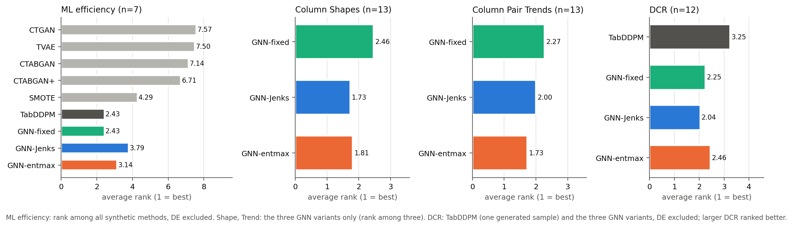
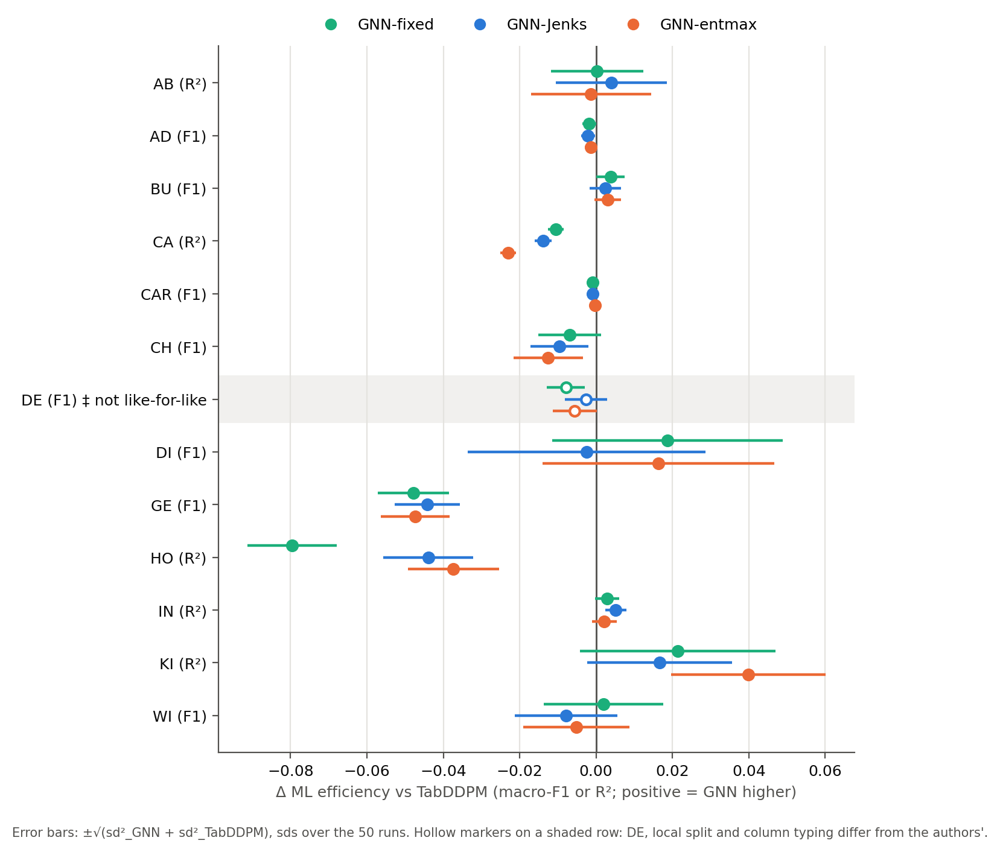

# Results (paper-style presentation)

_Generated by `analysis/paper_tables/paper_tables.py`; rerun it to refresh. LaTeX versions in `tables/`, figures (PDF + PNG) in `figures/`, numbers behind every cell in the CSV files._

Methods: Real (CatBoost on the real train split); CTGAN, TVAE, CTABGAN, CTABGAN+, SMOTE (reported in the TabDDPM paper, Table 5, same tuned-CatBoost protocol); TabDDPM (authors' released evaluation); GNN-fixed, GNN-Jenks, GNN-entmax (ours; the three top-k rules on the GNN configuration used for each dataset, listed at the end). No GNN results are available for FB, HI, MI.

## Summary of results

- **ML efficiency.** Over the 7 datasets where every synthetic method has a value, the average ranks are TabDDPM 2.43, GNN-fixed 2.43, GNN-entmax 3.14, GNN-Jenks 3.79, SMOTE 4.29, CTABGAN+ 6.71, CTABGAN 7.14, TVAE 7.50, CTGAN 7.57. Without CTABGAN (12 datasets): TabDDPM 2.62, GNN-fixed 2.62, GNN-Jenks 3.21, GNN-entmax 3.21, SMOTE 3.58, CTABGAN+ 6.58, TVAE 6.83, CTGAN 7.33.
- **GNN-fixed vs TabDDPM** (n = 12, DE excluded): higher on 6, lower on 6 datasets; median Δ = -0.0003, mean Δ = -0.0082; Wilcoxon p = 0.791 (Holm 0.848).
- **GNN-Jenks vs TabDDPM** (n = 12, DE excluded): higher on 4, lower on 8 datasets; median Δ = -0.0023, mean Δ = -0.0081; Wilcoxon p = 0.266 (Holm 0.798).
- **GNN-entmax vs TabDDPM** (n = 12, DE excluded): higher on 4, lower on 8 datasets; median Δ = -0.0014, mean Δ = -0.0056; Wilcoxon p = 0.424 (Holm 0.848).
- **Column Shapes** (n = 13): average rank GNN-Jenks 1.73, GNN-entmax 1.81, GNN-fixed 2.46.
- **Column Pair Trends** (n = 13): average rank GNN-entmax 1.73, GNN-Jenks 2.00, GNN-fixed 2.27.
- **DCR** (n = 12): average rank GNN-Jenks 2.04, GNN-fixed 2.25, GNN-entmax 2.46, TabDDPM 3.25 (larger DCR ranked better; TabDDPM from one generated sample).
- **DCR / holdout DCR** across datasets (min / median / max): TabDDPM 0.40 / 0.99 / 1.17 (n = 12); GNN-fixed 0.86 / 1.02 / 1.14 (n = 13); GNN-Jenks 0.87 / 1.01 / 1.15 (n = 13); GNN-entmax 0.84 / 1.02 / 1.24 (n = 13).
- **MIA AUC** range across datasets: GNN-fixed 0.495–0.567; GNN-Jenks 0.496–0.550; GNN-entmax 0.496–0.564.

## Table 1 — Machine learning efficiency

| Method | AB (R²) | AD (F1) | BU (F1) | CA (R²) | CAR (F1) | CH (F1) | DE ‡ (F1) | DI (F1) | FB (R²) | GE (F1) | HI (F1) | HO (R²) | IN (R²) | KI (R²) | MI (F1) | WI (F1) | Rank (n=7) | Rank w/o CTABGAN (n=12) |
|---|---|---|---|---|---|---|---|---|---|---|---|---|---|---|---|---|---|---|
| *Real* | 0.556 ±.004 | 0.815 ±.002 | 0.906 ±.002 | 0.857 ±.001 | 0.738 ±.001 | 0.740 ±.009 | 0.688 ±.003 | 0.785 ±.013 | 0.837 ±.001 | 0.636 ±.007 | 0.724 ±.001 | 0.662 ±.003 | 0.814 ±.001 | 0.907 ±.002 | 0.934 ±.000 | 0.898 ±.006 |  |  |
| CTGAN † | 0.420 ±.004 | 0.789 ±.001 | 0.867 ±.003 | 0.686 ±.003 | 0.730 ±.001 | 0.723 ±.006 | 0.699 ±.002 | 0.459 ±.096 | 0.443 ±.005 | 0.333 ±.013 | 0.575 ±.006 | 0.433 ±.005 | 0.745 ±.009 | 0.772 ±.005 | 0.783 ±.005 | 0.749 ±.015 | 7.57 | 7.33 |
| TVAE † | 0.433 ±.008 | 0.781 ±.002 | 0.864 ±.005 | 0.752 ±.001 | 0.717 ±.001 | 0.732 ±.006 | 0.656 ±.007 | 0.714 ±.039 | 0.685 ±.003 | 0.434 ±.006 | 0.638 ±.003 | 0.493 ±.006 | 0.784 ±.010 | 0.824 ±.003 | 0.912 ±.001 | 0.501 ±.012 | 7.50 | 6.83 |
| CTABGAN † | — | 0.783 ±.002 | 0.855 ±.005 | — | 0.717 ±.001 | 0.688 ±.006 | 0.644 ±.011 | 0.731 ±.022 | — | 0.392 ±.006 | 0.575 ±.004 | — | — | — | 0.889 ±.002 | <u>0.906</u> ±.019 | 7.14 | — |
| CTABGAN+ † | 0.467 ±.004 | 0.772 ±.003 | 0.884 ±.005 | 0.525 ±.004 | 0.733 ±.001 | 0.702 ±.012 | 0.686 ±.004 | 0.734 ±.020 | 0.509 ±.011 | 0.406 ±.009 | <u>0.664</u> ±.002 | 0.504 ±.005 | 0.797 ±.005 | 0.444 ±.014 | 0.892 ±.002 | 0.798 ±.021 | 6.71 | 6.58 |
| SMOTE † | 0.549 ±.005 | 0.791 ±.002 | 0.891 ±.003 | **0.840** ±.001 | 0.732 ±.001 | 0.743 ±.005 | 0.693 ±.003 | 0.683 ±.037 | **0.803** ±.002 | **0.658** ±.007 | **0.722** ±.001 | <u>0.662</u> ±.004 | <u>0.812</u> ±.002 | 0.842 ±.004 | <u>0.932</u> ±.001 | **0.913** ±.007 | 4.29 | 3.58 |
| TabDDPM | <u>0.550</u> ±.010 | **0.795** ±.001 | 0.906 ±.003 | <u>0.836</u> ±.002 | **0.737** ±.001 | **0.755** ±.006 | 0.691 ±.004 | 0.740 ±.020 | <u>0.713</u> ±.002 | <u>0.597</u> ±.006 | **0.722** ±.001 | **0.677** ±.010 | 0.809 ±.002 | 0.833 ±.014 | **0.936** ±.001 | 0.904 ±.009 | 2.43 | 2.62 |
| GNN-fixed | <u>0.550</u> ±.006 | 0.793 ±.001 | **0.909** ±.002 | 0.826 ±.001 | **0.737** ±.001 | <u>0.748</u> ±.006 | 0.683 ±.003 | **0.758** ±.023 | — | 0.549 ±.007 | — | 0.597 ±.007 | <u>0.812</u> ±.002 | <u>0.855</u> ±.021 | — | <u>0.906</u> ±.013 | 2.43 | 2.62 |
| GNN-Jenks | **0.554** ±.010 | 0.793 ±.001 | <u>0.908</u> ±.003 | 0.822 ±.002 | <u>0.736</u> ±.001 | 0.745 ±.005 | 0.688 ±.004 | 0.737 ±.024 | — | 0.552 ±.006 | — | 0.633 ±.007 | **0.814** ±.001 | 0.850 ±.012 | — | 0.897 ±.010 | 3.79 | 3.21 |
| GNN-entmax | 0.549 ±.012 | <u>0.794</u> ±.001 | **0.909** ±.002 | 0.813 ±.001 | **0.737** ±.001 | 0.742 ±.007 | 0.685 ±.004 | <u>0.756</u> ±.023 | — | 0.549 ±.007 | — | 0.639 ±.007 | 0.811 ±.002 | **0.873** ±.014 | — | 0.899 ±.011 | 3.14 | 3.21 |

Mean ± std over 5 generation seeds × 10 CatBoost seeds (50 runs; std with ddof=0) of macro-F1 (classification) or R² (regression) on the test split, CatBoost tuned per dataset on real data. **Bold** = best and <u>underline</u> = second best synthetic method per dataset (on the values as displayed; Real is not ranked). † reported: values from Kotelnikov et al. (TabDDPM, arXiv:2209.15421v2, Table 5), same protocol. Real and TabDDPM: the authors' released evaluation files (exp/<ds>/ddpm_cb_best/eval_catboost.json). — = not available. Rank = average rank (1 = best) over the 7 datasets where every synthetic method has a value (AD, BU, CAR, CH, DI, GE, WI); the second rank column drops CTABGAN, which has no regression results, and covers 12 datasets (AB, AD, BU, CA, CAR, CH, DI, GE, HO, IN, KI, WI). ‡ DE: our local default split and column typing differ from the authors', so the reported, Real and TabDDPM values on DE are not like-for-like with ours; DE is not highlighted and is excluded from both rank columns.

## Table 2 — Fidelity: Column Shapes and Column Pair Trends (ours only)

**Column Shapes error (%) ↓**

| Method | AB | AD | BU | CA | CAR | CH | DE | DI | FB | GE | HI | HO | IN | KI | MI | WI | Rank (n=13) |
|---|---|---|---|---|---|---|---|---|---|---|---|---|---|---|---|---|---|
| *Real test* | 2.70 | 0.64 | 1.64 | 1.42 | 0.54 | 1.49 | 0.98 | 7.74 | — | 1.98 | — | 1.51 | 3.26 | 1.31 | — | 2.94 |  |
| GNN-fixed | 3.07 ±.33 | **0.81** ±.04 | 1.54 ±.27 | **1.57** ±.17 | 0.59 ±.11 | <u>1.42</u> ±.10 | 7.19 ±.15 | 7.80 ±.58 | — | 2.91 ±.34 | — | 1.68 ±.10 | 4.54 ±1.31 | 1.86 ±.12 | — | **2.53** ±.39 | 2.46 |
| GNN-Jenks | <u>3.00</u> ±.33 | <u>0.82</u> ±.07 | <u>1.52</u> ±.22 | <u>1.62</u> ±.13 | **0.56** ±.08 | **1.41** ±.13 | <u>6.76</u> ±.15 | **7.34** ±.74 | — | **2.55** ±.28 | — | <u>1.67</u> ±.06 | <u>4.20</u> ±.85 | <u>1.73</u> ±.12 | — | <u>2.55</u> ±.40 | 1.73 |
| GNN-entmax | **2.85** ±.43 | 0.95 ±.04 | **1.47** ±.33 | <u>1.62</u> ±.16 | <u>0.57</u> ±.09 | 1.46 ±.07 | **6.68** ±.18 | <u>7.42</u> ±.56 | — | <u>2.59</u> ±.21 | — | **1.51** ±.05 | **4.14** ±1.07 | **1.71** ±.13 | — | 2.56 ±.44 | 1.81 |

**Column Pair Trends error (%) ↓**

| Method | AB | AD | BU | CA | CAR | CH | DE | DI | FB | GE | HI | HO | IN | KI | MI | WI | Rank (n=13) |
|---|---|---|---|---|---|---|---|---|---|---|---|---|---|---|---|---|---|
| *Real test* | 1.96 | 1.60 | 4.06 | 0.82 | 1.03 | 2.87 | 1.52 | 4.92 | — | 2.68 | — | 1.10 | 8.12 | 0.98 | — | 2.41 |  |
| GNN-fixed | **3.21** ±.43 | **2.01** ±.02 | 3.90 ±.10 | **0.75** ±.14 | 0.87 ±.34 | <u>2.55</u> ±.11 | 2.41 ±.24 | **5.34** ±.32 | — | 2.08 ±.10 | — | 0.97 ±.13 | 8.12 ±1.03 | <u>1.81</u> ±.08 | — | 2.59 ±1.34 | 2.27 |
| GNN-Jenks | 3.31 ±.61 | <u>2.16</u> ±.10 | <u>3.82</u> ±.09 | 0.82 ±.19 | **0.77** ±.13 | **2.50** ±.16 | <u>2.13</u> ±.16 | 7.25 ±1.06 | — | **1.94** ±.11 | — | <u>0.85</u> ±.12 | **7.50** ±.65 | 2.05 ±.08 | — | <u>2.21</u> ±.86 | 2.00 |
| GNN-entmax | <u>3.30</u> ±.54 | 2.48 ±.02 | **3.81** ±.21 | <u>0.77</u> ±.11 | <u>0.84</u> ±.20 | <u>2.55</u> ±.08 | **1.96** ±.25 | <u>5.88</u> ±.52 | — | <u>2.07</u> ±.10 | — | **0.79** ±.11 | <u>7.72</u> ±.39 | **1.68** ±.08 | — | **2.03** ±.62 | 1.73 |

Error = 100 × (1 − score), lower is better; mean ± sd over 5 generation seeds (sd with ddof=1). Column Shapes: SDMetrics per-column similarity (KS complement for numerical, TV complement for categorical columns) averaged over columns. Column Pair Trends: correlation / contingency similarity averaged over ALL column pairs, each pair scored on bins shared between real and synthetic data (not the SDMetrics QualityReport aggregate). Each synthetic sample (and the Real-test reference) is compared with the real train split on the same number of rows. *Real test* = the real test split scored against the real train split (sampling-noise reference). **Bold** best, <u>underline</u> second best among the three GNN variants; Rank = average over the 13 datasets with all three. **These values are computed with our own implementation and splits and are not comparable to the Shape/Trend numbers reported in the TabDiff paper.**

## Table 3 — Privacy

**DCR (median nearest-neighbour L2 to real train) ↑**

| Method | AB | AD | BU | CA | CAR | CH | DE | DI | FB | GE | HI | HO | IN | KI | MI | WI |
|---|---|---|---|---|---|---|---|---|---|---|---|---|---|---|---|---|
| *Holdout* | 0.0490 | 0.1059 | 0.1642 | 0.0408 | 0.0114 | 0.2146 | 0.0743 | 0.1744 | — | 0.0840 | — | 0.0948 | 0.1015 | 0.1752 | — | 0.0166 |
| TabDDPM § | 0.0499 | 0.1044 | 0.1430 | 0.0406 | 0.0122 | 0.1574 | 0.1123 ‡ | 0.2036 | 0.1115 ◇ | 0.0589 | 0.4487 ◇ | 0.0859 | 0.0405 | 0.1887 | 0.0219 ◇ | 0.0164 |
| GNN-fixed | 0.0499 ±.0001 | 0.1163 ±.0003 | 0.1635 ±.0004 | 0.0436 ±.0002 | 0.0116 ±.0000 | 0.2150 ±.0007 | 0.0849 ±.0002 | 0.1758 ±.0032 | — | 0.0862 ±.0005 | — | 0.0953 ±.0000 | 0.0872 ±.0007 | 0.1992 ±.0005 | — | 0.0165 ±.0001 |
| GNN-Jenks | 0.0496 ±.0002 | 0.1223 ±.0005 | 0.1644 ±.0006 | 0.0441 ±.0001 | 0.0116 ±.0000 | 0.2151 ±.0006 | 0.0815 ±.0003 | 0.1808 ±.0034 | — | 0.0851 ±.0004 | — | 0.0951 ±.0001 | 0.0886 ±.0014 | 0.1959 ±.0005 | — | 0.0165 ±.0001 |
| GNN-entmax | 0.0491 ±.0002 | 0.1317 ±.0004 | 0.1652 ±.0005 | 0.0445 ±.0001 | 0.0116 ±.0000 | 0.2148 ±.0006 | 0.0802 ±.0001 | 0.1799 ±.0045 | — | 0.0884 ±.0007 | — | 0.0945 ±.0001 | 0.0856 ±.0008 | 0.1944 ±.0006 | — | 0.0164 ±.0001 |

**DCR / holdout DCR**

| Method | AB | AD | BU | CA | CAR | CH | DE | DI | FB | GE | HI | HO | IN | KI | MI | WI |
|---|---|---|---|---|---|---|---|---|---|---|---|---|---|---|---|---|
| TabDDPM § | 1.019 | 0.985 | 0.871 | 0.994 | 1.072 | 0.733 | — | 1.167 | — | 0.701 | — | 0.906 | 0.399 | 1.077 | — | 0.987 |
| GNN-fixed | 1.018 ±.003 | 1.098 ±.003 | 0.996 ±.002 | 1.067 ±.004 | 1.018 ±.002 | 1.001 ±.003 | 1.143 ±.003 | 1.008 ±.019 | — | 1.026 ±.005 | — | 1.005 ±.000 | 0.858 ±.007 | 1.136 ±.003 | — | 0.989 ±.004 |
| GNN-Jenks | 1.012 ±.004 | 1.155 ±.005 | 1.001 ±.004 | 1.079 ±.001 | 1.020 ±.002 | 1.002 ±.003 | 1.097 ±.004 | 1.037 ±.020 | — | 1.013 ±.005 | — | 1.004 ±.001 | 0.873 ±.013 | 1.118 ±.003 | — | 0.989 ±.005 |
| GNN-entmax | 1.002 ±.004 | 1.243 ±.003 | 1.006 ±.003 | 1.091 ±.003 | 1.018 ±.002 | 1.001 ±.003 | 1.079 ±.002 | 1.032 ±.026 | — | 1.052 ±.008 | — | 0.997 ±.001 | 0.843 ±.008 | 1.110 ±.003 | — | 0.987 ±.003 |

**MIA AUC (→ 0.5)**

| Method | AB | AD | BU | CA | CAR | CH | DE | DI | FB | GE | HI | HO | IN | KI | MI | WI |
|---|---|---|---|---|---|---|---|---|---|---|---|---|---|---|---|---|
| GNN-fixed | 0.495 ±.005 | 0.504 ±.001 | 0.508 ±.003 | 0.504 ±.003 | 0.500 ±.002 | 0.506 ±.004 | 0.495 ±.001 | 0.540 ±.016 | — | 0.501 ±.001 | — | 0.508 ±.001 | 0.567 ±.022 | 0.503 ±.001 | — | 0.528 ±.007 |
| GNN-Jenks | 0.497 ±.004 | 0.503 ±.001 | 0.507 ±.003 | 0.505 ±.001 | 0.499 ±.003 | 0.505 ±.004 | 0.496 ±.001 | 0.540 ±.023 | — | 0.501 ±.001 | — | 0.508 ±.002 | 0.550 ±.020 | 0.504 ±.001 | — | 0.531 ±.010 |
| GNN-entmax | 0.496 ±.003 | 0.503 ±.001 | 0.504 ±.003 | 0.503 ±.004 | 0.500 ±.001 | 0.505 ±.005 | 0.497 ±.002 | 0.532 ±.020 | — | 0.501 ±.001 | — | 0.508 ±.001 | 0.564 ±.013 | 0.504 ±.001 | — | 0.530 ±.008 |

DCR: median, over synthetic rows, of the L2 distance to the closest real training row (numerical columns min-max scaled and categorical columns one-hot / √2, both fitted on real train; target included). GNN rows: mean ± sd over 5 generation seeds. § TabDDPM: the authors' exp/<ds>/ddpm_cb_best/privacy.json, the same statistic computed by the same code (scripts/resample_privacy.py `privacy_metrics`, median), on one generated sample, so no sd; that code reproduces our stored GNN DCR to ~1e-12 when run on our samples (`DCR_RECIPE_CHECK.md`). It subsamples the synthetic rows to 50,000 when more were generated (≤0.4% effect on the median, measured on our samples) and the real train rows to 50,000 when more exist: ◇ = real train set subsampled (FB, HI, MI), not comparable to an all-rows DCR. ‡ DE: computed on the authors' version of the dataset, not like-for-like. *Holdout*: the same statistic for the real test split, i.e. the distance a fresh sample from the data distribution has to the training set; DCR / holdout ≈ 1 means synthetic rows are as far from the training rows as unseen real rows, < 1 closer (not computed where ‡ or ◇). MIA AUC: distance-based membership-inference attack (train vs test rows scored by proximity to the synthetic set), 0.5 = no leakage; not available for TabDDPM. No value is highlighted: a larger DCR is not unconditionally better (it can also reflect lower fidelity).

## Table 4 — Summary

| Method | MLE (n=7) | MLE w/o CTABGAN (n=12) | Shape (n=13) | Trend (n=13) | DCR (n=12) | median Δ MLE vs TabDDPM | Wilcoxon p / Holm (n=12) |
|---|---|---|---|---|---|---|---|
| CTGAN † | 7.57 (0/7) | 7.33 (0/12) | — | — | — | — | — |
| TVAE † | 7.50 (0/7) | 6.83 (0/12) | — | — | — | — | — |
| CTABGAN † | 7.14 (0/7) | — | — | — | — | — | — |
| CTABGAN+ † | 6.71 (0/7) | 6.58 (0/12) | — | — | — | — | — |
| SMOTE † | 4.29 (2/7) | 3.58 (3/12) | — | — | — | — | — |
| TabDDPM | 2.43 (3/7) | 2.62 (4/12) | — | — | 3.25 (3/12) | — | — |
| GNN-fixed | 2.43 (3/7) | 2.62 (3/12) | 2.46 (3/13) | 2.27 (4/13) | 2.25 (4/12) | -0.0003 | 0.791 / 0.848 |
| GNN-Jenks | 3.79 (0/7) | 3.21 (2/12) | 1.73 (4/13) | 2.00 (4/13) | 2.04 (3/12) | -0.0023 | 0.266 / 0.798 |
| GNN-entmax | 3.14 (2/7) | 3.21 (3/12) | 1.81 (6/13) | 1.73 (5/13) | 2.46 (4/12) | -0.0014 | 0.424 / 0.848 |

Each metric cell: average rank (1 = best) over the n datasets where every method ranked in that column has a value, and in brackets the number of those datasets on which the method ranks first (ties count for every tied method). MLE ranks are over all synthetic methods of Table 1 (DE excluded); Shape and Trend are available for our three variants only (ranks among three); DCR for TabDDPM and our three variants (ranks among four; DE and the datasets whose real train set the TabDDPM DCR subsamples excluded; TabDDPM's DCR is from one generated sample). These ranks are therefore not on the same scale as the MLE ranks. Shape/Trend: lower error is better; DCR: larger is ranked better. Last two columns: per-dataset difference in ML efficiency, GNN variant minus TabDDPM (authors' values), over the n = 12 datasets where both exist (DE excluded); two-sided Wilcoxon signed-rank test, p-values raw and Holm-corrected over the three variants. † reported values (TabDDPM paper, Table 5).

## Figures

## GNN configuration used for each dataset

| Dataset | GNN | layers | d_model | top-k (fixed) | heads |
|---|---|---|---|---|---|
| abalone (AB) | GATv2 | 3 | 64 | 3 | 4 |
| adult (AD) | GCN | 2 | 128 | 5 | 4 |
| buddy (BU) | GCN | 2 | 256 | 5 | 4 |
| california (CA) | GCN | 2 | 256 | 5 | 4 |
| cardio (CAR) | GATv2 | 3 | 128 | 5 | 8 |
| churn2 (CH) | GATv2 | 2 | 128 | 5 | 4 |
| default (DE) | GATv2 | 3 | 128 | 5 | 8 |
| diabetes (DI) | GIN | 2 | 32 | 5 | 4 |
| fb-comments (FB) | — | — | — | — | — |
| gesture (GE) | GAT | 3 | 128 | 5 | 4 |
| higgs-small (HI) | — | — | — | — | — |
| house (HO) | GATv2 | 3 | 128 | 5 | 8 |
| insurance (IN) | GATv2 | 2 | 64 | 5 | 4 |
| king (KI) | GATv2 | 3 | 128 | 5 | 8 |
| miniboone (MI) | — | — | — | — | — |
| wilt (WI) | GATv2 | 2 | 64 | 3 | 8 |

## Data sources

- Every file read is listed in `provenance.csv` (122 distinct paths). The guard aborts on any path containing `tddpm_setup`: the budget-matched runs are not read. Such trees present on disk (not opened): none.
- TabDDPM's DCR (`privacy.json`) is the same statistic as our DCR, computed by the same code: `dcr_recipe_check.py` runs the authors' `privacy_metrics` verbatim on our samples (see `DCR_RECIPE_CHECK.md`).
- Holdout DCR recomputed from `data/<ds>/` with the protocol's own DCR code; self-check that the same code reproduces a stored synthetic DCR: transfer_runs/exp/abalone/ablation_catfix/gnn_gatv2_layers3_dim64_topk3_heads4_noattn/gen_seed_0: stored 0.049918, recomputed 0.049918.

