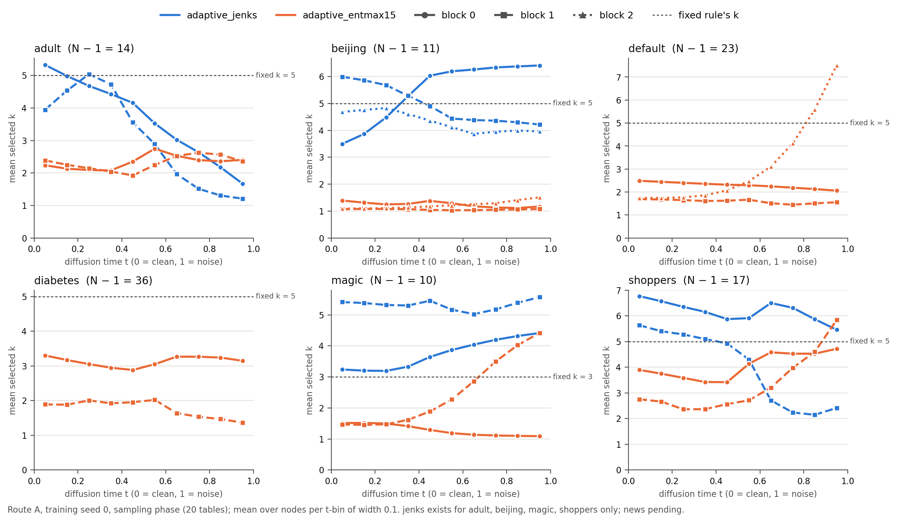

# Comparison tables (supervisor summary)

_Generated 2026-10-16 13:36 by `analysis/summary/build_summary.py` at commit `9f86515` (+ uncommitted changes). Rerun it to refresh; nothing is trained or sampled._

## How values are marked

- Every value comes from a results file; `csv/<table>.csv` lists, per value, its **kind** (`computed` by us / `reported` from a paper or the authors' release), its **source** file(s) and the **commit** (the last git commit touching a tracked file; for gitignored run outputs `untracked` + the file's sha256/16, plus the producing run's own `git_commit` from its run_meta.json). `provenance.csv` lists every file read. Ranks, ratios and win/tie/loss counts are marked `derived`.
- In the tables: — = no value: ᵖ not reported, ⁿ not computed, ᵃ not applicable, ᵈ no run on disk; **pending** = run still in progress. † = reported (paper, or the authors' released evaluation files); unmarked values are computed by us.
- Cross-check: every A-table mean that also appears in a run's own results_full_averaged.json matches it (max |difference| = 4.4e-16 over 324 values).

## A. TabDDPM framework (thesis core)

13 datasets (higgs-small, miniboone, fb-comments excluded). Layout: our GNN denoiser, one table per neighbour-selection rule (A1–A3, each followed by its block of all other recorded metrics), then TabDDPM on the same datasets and columns (A4), the summary (A5) and the budget-matched experiment (A6). A0 gives the real-data reference.

### A0. Real-data reference (TabDDPM framework)

**How to read.** What real data achieve on each metric: the ceiling for MLE and the sampling-noise floor for Shape / Trend / DCR. Read every GNN or TabDDPM value against its row here.

**Protocol.** Real MLE: CatBoost trained on the real train split, test split (paper Table 5 and the authors' released eval_catboost.json). Shape / Trend / holdout DCR: the real test split scored against the real train split with exactly the code used for the synthetic samples.

| Dataset | unit | MLE (paper) | MLE (authors' release) | Shape err (%), real test | Trend err (%), real test | holdout DCR |
|---|---|---|---|---|---|---|
| abalone \* | R² | 0.556 ± 0.004† | 0.5562 ± 0.0038† | 2.70 | 1.96 | 0.0490 |
| adult \* | F1 | 0.815 ± 0.002† | 0.8152 ± 0.0017† | 0.64 | 1.60 | 0.1059 |
| buddy \* | F1 | 0.906 ± 0.002† | 0.9063 ± 0.0018† | 1.64 | 4.06 | 0.1642 |
| california \* | R² | 0.857 ± 0.001† | 0.8568 ± 0.0013† | 1.42 | 0.82 | 0.0408 |
| cardio | F1 | 0.738 ± 0.001† | 0.7379 ± 0.0008† | 0.54 | 1.03 | 0.0114 |
| churn2 \* | F1 | 0.740 ± 0.009† | 0.7403 ± 0.0086† | 1.49 | 2.87 | 0.2146 |
| default ‡ | F1 | 0.688 ± 0.003† | 0.6880 ± 0.0028† | 0.98 | 1.52 | 0.0743 |
| diabetes \* | F1 | 0.785 ± 0.013† | 0.7849 ± 0.0129† | 7.74 | 4.92 | 0.1744 |
| gesture \* | F1 | 0.636 ± 0.007† | 0.6365 ± 0.0073† | 1.98 | 2.68 | 0.0840 |
| house | R² | 0.662 ± 0.003† | 0.6616 ± 0.0027† | 1.51 | 1.10 | 0.0948 |
| insurance \* | R² | 0.814 ± 0.001† | 0.8137 ± 0.0012† | 3.26 | 8.12 | 0.1015 |
| king | R² | 0.907 ± 0.002† | 0.9070 ± 0.0022† | 1.31 | 0.98 | 0.1752 |
| wilt \* | F1 | 0.898 ± 0.006† | 0.8982 ± 0.0063† | 2.94 | 2.41 | 0.0166 |

\* development dataset; ‡ default: the paper's and the authors' values are on the authors' version of the data. — = no value: ᵖ not reported, ⁿ not computed, ᵃ not applicable, ᵈ no run on disk; **pending** = run still in progress. † = reported (paper, or the authors' released evaluation files); unmarked values are computed by us.

### A1. GNN denoiser, fixed top-k (TabDDPM framework)

**How to read.** Rows = datasets, one GNN-denoiser run cell each (the GNN configuration used for that dataset, neighbour-selection rule **fixed top-k**). MLE: macro-F1 ("macro avg/f1-score", not "score") for classification, R² for regression, higher is better. Shape / Trend: error = 100 × (1 − score), lower is better. DCR / holdout ≈ 1 means synthetic rows are as far from the training rows as unseen real rows. MIA AUC 0.5 = no membership leakage. The second block lists every other metric the runs recorded.

**Protocol.** TabDDPM framework (Gaussian + multinomial diffusion, TabDDPM's code); one trained model per cell (training seed 0), 20k steps, lr 1e-4, batch 4096, T = 1000 for every dataset (ablation_runner constants; TabDDPM's tuned budgets differ, see A6), EMA weights sampled; 5 generation seeds; MLE with the authors' tuned CatBoost, 10 CatBoost seeds per sample, test split.

| Dataset | MLE unit | MLE: F1 / R² ↑ | Shape err (%) ↓ | Trend err (%) ↓ | DCR ↑ | DCR / holdout | MIA AUC (→ 0.5) | Wasserstein ↓ | Params |
|---|---|---|---|---|---|---|---|---|---|
| abalone \* | R² | 0.5501 ± 0.0064 | 3.07 ± 0.33 | 3.21 ± 0.43 | 0.0499 ± 0.0001 | 1.018 ± 0.003 | 0.495 ± 0.005 | 0.0387 ± 0.0071 | 350,475 |
| adult \* | F1 | 0.7933 ± 0.0011 | 0.81 ± 0.04 | 2.01 ± 0.02 | 0.1163 ± 0.0003 | 1.098 ± 0.003 | 0.504 ± 0.001 | 0.0124 ± 0.0005 | 723,308 |
| buddy \* | F1 | 0.9095 ± 0.0022 | 1.54 ± 0.27 | 3.90 ± 0.10 | 0.1635 ± 0.0004 | 0.996 ± 0.002 | 0.508 ± 0.003 | 0.0072 ± 0.0008 | 2,733,536 |
| california \* | R² | 0.8256 ± 0.0014 | 1.57 ± 0.17 | 0.75 ± 0.14 | 0.0436 ± 0.0002 | 1.067 ± 0.004 | 0.504 ± 0.003 | 0.0137 ± 0.0014 | 2,688,137 |
| cardio | F1 | 0.7366 ± 0.0006 | 0.59 ± 0.11 | 0.87 ± 0.34 | 0.0116 ± 0.0000 | 1.018 ± 0.002 | 0.500 ± 0.002 | 0.0101 ± 0.0004 | 1,325,971 |
| churn2 \* | F1 | 0.7479 ± 0.0056 | 1.42 ± 0.10 | 2.55 ± 0.11 | 0.2150 ± 0.0007 | 1.001 ± 0.003 | 0.506 ± 0.004 | 0.0119 ± 0.0011 | 896,400 |
| default ‡ | F1 | 0.6831 ± 0.0030 | 7.19 ± 0.15 | 2.41 ± 0.24 | 0.0849 ± 0.0002 | 1.143 ± 0.003 | 0.495 ± 0.001 | 0.2120 ± 0.1421 | 1,346,011 |
| diabetes \* | F1 | 0.7585 ± 0.0229 | 7.80 ± 0.58 | 5.34 ± 0.32 | 0.1758 ± 0.0032 | 1.008 ± 0.019 | 0.540 ± 0.016 | 0.0728 ± 0.0029 | 76,268 |
| gesture \* | F1 | 0.5489 ± 0.0070 | 2.91 ± 0.34 | 2.08 ± 0.10 | 0.0862 ± 0.0005 | 1.026 ± 0.005 | 0.501 ± 0.001 | 0.0771 ± 0.0007 | 1,136,544 |
| house | R² | 0.5971 ± 0.0067 | 1.68 ± 0.10 | 0.97 ± 0.13 | 0.0953 ± 0.0000 | 1.005 ± 0.000 | 0.508 ± 0.001 | 0.0256 ± 0.0006 | 1,325,969 |
| insurance \* | R² | 0.8121 ± 0.0021 | 4.54 ± 1.31 | 8.12 ± 1.03 | 0.0872 ± 0.0007 | 0.858 ± 0.007 | 0.567 ± 0.022 | 0.0328 ± 0.0024 | 242,572 |
| king | R² | 0.8545 ± 0.0213 | 1.86 ± 0.12 | 1.81 ± 0.08 | 0.1992 ± 0.0005 | 1.136 ± 0.003 | 0.503 ± 0.001 | 0.0264 ± 0.0010 | 1,329,822 |
| wilt \* | F1 | 0.9064 ± 0.0128 | 2.53 ± 0.39 | 2.59 ± 1.34 | 0.0165 ± 0.0001 | 0.989 ± 0.004 | 0.528 ± 0.007 | 0.0244 ± 0.0019 | 241,669 |

\* development dataset (GNN configuration selected on the test split, in-sample); ‡ local default data differ from the TabDDPM authors'. MLE and the other CatBoost metrics: mean ± std over 5 generation × 10 CatBoost seeds (50 runs, ddof=0). Shape, Trend, DCR, MIA, Wasserstein, association distances: mean ± sd over 5 generation seeds (ddof=1). DCR = median L2 distance of each synthetic row to its closest real training row (target included); holdout DCR = the same statistic for the real test split (table A0). Params = trainable parameters of the denoiser, instantiated on the dataset's shapes. — = no value: ᵖ not reported, ⁿ not computed, ᵃ not applicable, ᵈ no run on disk; **pending** = run still in progress. † = reported (paper, or the authors' released evaluation files); unmarked values are computed by us.

### A1x. GNN denoiser, fixed top-k: all other recorded metrics

**How to read.** Continuation of A1: same run cells, same seeds; rows = datasets.

**Protocol.** TabDDPM framework (Gaussian + multinomial diffusion, TabDDPM's code); one trained model per cell (training seed 0), 20k steps, lr 1e-4, batch 4096, T = 1000 for every dataset (ablation_runner constants; TabDDPM's tuned budgets differ, see A6), EMA weights sampled; 5 generation seeds; MLE with the authors' tuned CatBoost, 10 CatBoost seeds per sample, test split.

| Dataset | Accuracy ↑ | RMSE ↓ | ROC AUC ↑ | macro-P ↑ | macro-R ↑ | weighted-F1 ↑ | weighted-P ↑ | weighted-R ↑ | DCR mean-L2, no label | assoc. dist. (mean abs) ↓ | assoc. dist. (Frobenius) ↓ |
|---|---|---|---|---|---|---|---|---|---|---|---|
| abalone \* | —ᵃ | 2.0231 ± 0.0143 | —ᵃ | —ᵃ | —ᵃ | —ᵃ | —ᵃ | —ᵃ | 0.0487 ± 0.0005 | 0.0450 ± 0.0108 | 0.500 ± 0.158 |
| adult \* | 0.8598 ± 0.0008 | —ᵃ | 0.9129 ± 0.0004 | 0.8161 ± 0.0019 | 0.7768 ± 0.0016 | 0.8552 ± 0.0008 | 0.8541 ± 0.0009 | 0.8598 ± 0.0008 | 0.3080 ± 0.0006 | 0.0113 ± 0.0007 | 0.282 ± 0.017 |
| buddy \* | 0.8964 ± 0.0029 | —ᵃ | —ⁿ | 0.9146 ± 0.0030 | 0.9050 ± 0.0023 | 0.8963 ± 0.0029 | 0.8969 ± 0.0030 | 0.8964 ± 0.0029 | 0.2006 ± 0.0008 | 0.0146 ± 0.0022 | 0.176 ± 0.020 |
| california \* | —ᵃ | 0.4768 ± 0.0019 | —ᵃ | —ᵃ | —ᵃ | —ᵃ | —ᵃ | —ᵃ | 0.0343 ± 0.0001 | 0.0150 ± 0.0028 | 0.195 ± 0.056 |
| cardio | 0.7370 ± 0.0006 | —ᵃ | 0.8038 ± 0.0004 | 0.7388 ± 0.0007 | 0.7371 ± 0.0006 | 0.7365 ± 0.0006 | 0.7389 ± 0.0007 | 0.7370 ± 0.0006 | 0.0162 ± 0.0001 | 0.0087 ± 0.0054 | 0.257 ± 0.342 |
| churn2 \* | 0.8603 ± 0.0027 | —ᵃ | 0.8585 ± 0.0030 | 0.8128 ± 0.0080 | 0.7162 ± 0.0063 | 0.8477 ± 0.0031 | 0.8508 ± 0.0035 | 0.8603 ± 0.0027 | 0.2120 ± 0.0006 | 0.0143 ± 0.0028 | 0.226 ± 0.038 |
| default ‡ | 0.8170 ± 0.0025 | —ᵃ | 0.7610 ± 0.0122 | 0.7455 ± 0.0077 | 0.6598 ± 0.0036 | 0.7979 ± 0.0016 | 0.7993 ± 0.0028 | 0.8170 ± 0.0025 | 0.2641 ± 0.0654 | 0.0331 ± 0.0017 | 1.285 ± 0.142 |
| diabetes \* | 0.7881 ± 0.0199 | —ᵃ | 0.8472 ± 0.0296 | 0.7731 ± 0.0236 | 0.7511 ± 0.0227 | 0.7836 ± 0.0203 | 0.7852 ± 0.0201 | 0.7881 ± 0.0199 | 0.1843 ± 0.0017 | 0.0657 ± 0.0096 | 0.706 ± 0.107 |
| gesture \* | 0.6032 ± 0.0054 | —ᵃ | —ⁿ | 0.5669 ± 0.0074 | 0.5401 ± 0.0067 | 0.5954 ± 0.0057 | 0.5949 ± 0.0059 | 0.6032 ± 0.0054 | 0.1104 ± 0.0003 | 0.0385 ± 0.0018 | 1.735 ± 0.028 |
| house | —ᵃ | 34105.7 ± 284.7 | —ᵃ | —ᵃ | —ᵃ | —ᵃ | —ᵃ | —ᵃ | 0.1035 ± 0.0001 | 0.0195 ± 0.0026 | 0.449 ± 0.069 |
| insurance \* | —ᵃ | 4774.5 ± 26.1 | —ᵃ | —ᵃ | —ᵃ | —ᵃ | —ᵃ | —ᵃ | 0.0919 ± 0.0007 | 0.0418 ± 0.0071 | 0.351 ± 0.032 |
| king | —ᵃ | 133707.4 ± 9678.0 | —ᵃ | —ᵃ | —ᵃ | —ᵃ | —ᵃ | —ᵃ | 0.2212 ± 0.0005 | 0.0218 ± 0.0017 | 0.623 ± 0.039 |
| wilt \* | 0.9809 ± 0.0022 | —ᵃ | 0.9922 ± 0.0009 | 0.9048 ± 0.0081 | 0.9087 ± 0.0217 | 0.9810 ± 0.0024 | 0.9810 ± 0.0026 | 0.9809 ± 0.0022 | 0.0217 ± 0.0002 | 0.0412 ± 0.0248 | 0.326 ± 0.193 |

Every other metric recorded for the same run cells: the remaining CatBoost metrics of results_full_averaged.json ("score" = accuracy / −RMSE is a duplicate and not shown; "support" is a row count), the DCR variant without the target and with the mean instead of the median (not comparable with the TabDDPM authors' DCR), and the association-matrix distances of the dependency-fidelity analysis (real vs synthetic pairwise association, lower is better). — = no value: ᵖ not reported, ⁿ not computed, ᵃ not applicable, ᵈ no run on disk; **pending** = run still in progress. † = reported (paper, or the authors' released evaluation files); unmarked values are computed by us.

### A2. GNN denoiser, adaptive_jenks (TabDDPM framework)

**How to read.** Rows = datasets, one GNN-denoiser run cell each (the GNN configuration used for that dataset, neighbour-selection rule **adaptive_jenks**). MLE: macro-F1 ("macro avg/f1-score", not "score") for classification, R² for regression, higher is better. Shape / Trend: error = 100 × (1 − score), lower is better. DCR / holdout ≈ 1 means synthetic rows are as far from the training rows as unseen real rows. MIA AUC 0.5 = no membership leakage. The second block lists every other metric the runs recorded.

**Protocol.** TabDDPM framework (Gaussian + multinomial diffusion, TabDDPM's code); one trained model per cell (training seed 0), 20k steps, lr 1e-4, batch 4096, T = 1000 for every dataset (ablation_runner constants; TabDDPM's tuned budgets differ, see A6), EMA weights sampled; 5 generation seeds; MLE with the authors' tuned CatBoost, 10 CatBoost seeds per sample, test split.

| Dataset | MLE unit | MLE: F1 / R² ↑ | Shape err (%) ↓ | Trend err (%) ↓ | DCR ↑ | DCR / holdout | MIA AUC (→ 0.5) | Wasserstein ↓ | Params |
|---|---|---|---|---|---|---|---|---|---|
| abalone \* | R² | 0.5539 ± 0.0102 | 3.00 ± 0.33 | 3.31 ± 0.61 | 0.0496 ± 0.0002 | 1.012 ± 0.004 | 0.497 ± 0.004 | 0.0256 ± 0.0039 | 350,475 |
| adult \* | F1 | 0.7930 ± 0.0012 | 0.82 ± 0.07 | 2.16 ± 0.10 | 0.1223 ± 0.0005 | 1.155 ± 0.005 | 0.503 ± 0.001 | 0.0106 ± 0.0007 | 723,308 |
| buddy \* | F1 | 0.9081 ± 0.0029 | 1.52 ± 0.22 | 3.82 ± 0.09 | 0.1644 ± 0.0006 | 1.001 ± 0.004 | 0.507 ± 0.003 | 0.0063 ± 0.0005 | 2,733,536 |
| california \* | R² | 0.8223 ± 0.0016 | 1.62 ± 0.13 | 0.82 ± 0.19 | 0.0441 ± 0.0001 | 1.079 ± 0.001 | 0.505 ± 0.001 | 0.0140 ± 0.0013 | 2,688,137 |
| cardio | F1 | 0.7365 ± 0.0007 | 0.56 ± 0.08 | 0.77 ± 0.13 | 0.0116 ± 0.0000 | 1.020 ± 0.002 | 0.499 ± 0.003 | 0.0114 ± 0.0006 | 1,325,971 |
| churn2 \* | F1 | 0.7452 ± 0.0048 | 1.41 ± 0.13 | 2.50 ± 0.16 | 0.2151 ± 0.0006 | 1.002 ± 0.003 | 0.505 ± 0.004 | 0.0113 ± 0.0012 | 896,400 |
| default ‡ | F1 | 0.6883 ± 0.0037 | 6.76 ± 0.15 | 2.13 ± 0.16 | 0.0815 ± 0.0003 | 1.097 ± 0.004 | 0.496 ± 0.001 | 0.2994 ± 0.2212 | 1,346,011 |
| diabetes \* | F1 | 0.7374 ± 0.0242 | 7.34 ± 0.74 | 7.25 ± 1.06 | 0.1808 ± 0.0034 | 1.037 ± 0.020 | 0.540 ± 0.023 | 0.0944 ± 0.0147 | 76,268 |
| gesture \* | F1 | 0.5525 ± 0.0058 | 2.55 ± 0.28 | 1.94 ± 0.11 | 0.0851 ± 0.0004 | 1.013 ± 0.005 | 0.501 ± 0.001 | 0.0606 ± 0.0006 | 1,136,544 |
| house | R² | 0.6326 ± 0.0068 | 1.67 ± 0.06 | 0.85 ± 0.12 | 0.0951 ± 0.0001 | 1.004 ± 0.001 | 0.508 ± 0.002 | 0.0278 ± 0.0005 | 1,325,969 |
| insurance \* | R² | 0.8144 ± 0.0014 | 4.20 ± 0.85 | 7.50 ± 0.65 | 0.0886 ± 0.0014 | 0.873 ± 0.013 | 0.550 ± 0.020 | 0.0269 ± 0.0033 | 242,572 |
| king | R² | 0.8497 ± 0.0124 | 1.73 ± 0.12 | 2.05 ± 0.08 | 0.1959 ± 0.0005 | 1.118 ± 0.003 | 0.504 ± 0.001 | 0.0260 ± 0.0013 | 1,329,822 |
| wilt \* | F1 | 0.8966 ± 0.0100 | 2.55 ± 0.40 | 2.21 ± 0.86 | 0.0165 ± 0.0001 | 0.989 ± 0.005 | 0.531 ± 0.010 | 0.0237 ± 0.0020 | 241,669 |

\* development dataset (GNN configuration selected on the test split, in-sample); ‡ local default data differ from the TabDDPM authors'. MLE and the other CatBoost metrics: mean ± std over 5 generation × 10 CatBoost seeds (50 runs, ddof=0). Shape, Trend, DCR, MIA, Wasserstein, association distances: mean ± sd over 5 generation seeds (ddof=1). DCR = median L2 distance of each synthetic row to its closest real training row (target included); holdout DCR = the same statistic for the real test split (table A0). Params = trainable parameters of the denoiser, instantiated on the dataset's shapes. — = no value: ᵖ not reported, ⁿ not computed, ᵃ not applicable, ᵈ no run on disk; **pending** = run still in progress. † = reported (paper, or the authors' released evaluation files); unmarked values are computed by us.

### A2x. GNN denoiser, adaptive_jenks: all other recorded metrics

**How to read.** Continuation of A2: same run cells, same seeds; rows = datasets.

**Protocol.** TabDDPM framework (Gaussian + multinomial diffusion, TabDDPM's code); one trained model per cell (training seed 0), 20k steps, lr 1e-4, batch 4096, T = 1000 for every dataset (ablation_runner constants; TabDDPM's tuned budgets differ, see A6), EMA weights sampled; 5 generation seeds; MLE with the authors' tuned CatBoost, 10 CatBoost seeds per sample, test split.

| Dataset | Accuracy ↑ | RMSE ↓ | ROC AUC ↑ | macro-P ↑ | macro-R ↑ | weighted-F1 ↑ | weighted-P ↑ | weighted-R ↑ | DCR mean-L2, no label | assoc. dist. (mean abs) ↓ | assoc. dist. (Frobenius) ↓ |
|---|---|---|---|---|---|---|---|---|---|---|---|
| abalone \* | —ᵃ | 2.0145 ± 0.0231 | —ᵃ | —ᵃ | —ᵃ | —ᵃ | —ᵃ | —ᵃ | 0.0487 ± 0.0005 | 0.0487 ± 0.0126 | 0.556 ± 0.165 |
| adult \* | 0.8588 ± 0.0008 | —ᵃ | 0.9128 ± 0.0006 | 0.8133 ± 0.0014 | 0.7779 ± 0.0014 | 0.8546 ± 0.0008 | 0.8533 ± 0.0009 | 0.8588 ± 0.0008 | 0.3165 ± 0.0011 | 0.0171 ± 0.0003 | 0.421 ± 0.005 |
| buddy \* | 0.8958 ± 0.0028 | —ᵃ | —ⁿ | 0.9132 ± 0.0029 | 0.9038 ± 0.0034 | 0.8957 ± 0.0028 | 0.8964 ± 0.0030 | 0.8958 ± 0.0028 | 0.2027 ± 0.0007 | 0.0140 ± 0.0016 | 0.168 ± 0.013 |
| california \* | —ᵃ | 0.4813 ± 0.0022 | —ᵃ | —ᵃ | —ᵃ | —ᵃ | —ᵃ | —ᵃ | 0.0348 ± 0.0001 | 0.0165 ± 0.0039 | 0.229 ± 0.089 |
| cardio | 0.7369 ± 0.0007 | —ᵃ | 0.8042 ± 0.0004 | 0.7387 ± 0.0007 | 0.7370 ± 0.0007 | 0.7364 ± 0.0007 | 0.7388 ± 0.0007 | 0.7369 ± 0.0007 | 0.0164 ± 0.0000 | 0.0070 ± 0.0015 | 0.130 ± 0.052 |
| churn2 \* | 0.8587 ± 0.0026 | —ᵃ | 0.8535 ± 0.0042 | 0.8086 ± 0.0077 | 0.7141 ± 0.0051 | 0.8460 ± 0.0027 | 0.8487 ± 0.0033 | 0.8587 ± 0.0026 | 0.2119 ± 0.0005 | 0.0137 ± 0.0021 | 0.216 ± 0.028 |
| default ‡ | 0.8175 ± 0.0025 | —ᵃ | 0.7696 ± 0.0066 | 0.7444 ± 0.0072 | 0.6655 ± 0.0046 | 0.8002 ± 0.0019 | 0.8003 ± 0.0027 | 0.8175 ± 0.0025 | 0.2813 ± 0.0814 | 0.0260 ± 0.0027 | 1.078 ± 0.236 |
| diabetes \* | 0.7751 ± 0.0172 | —ᵃ | 0.8515 ± 0.0219 | 0.7615 ± 0.0192 | 0.7276 ± 0.0244 | 0.7670 ± 0.0200 | 0.7707 ± 0.0182 | 0.7751 ± 0.0172 | 0.2036 ± 0.0058 | 0.1016 ± 0.0211 | 1.106 ± 0.235 |
| gesture \* | 0.6076 ± 0.0047 | —ᵃ | —ⁿ | 0.5716 ± 0.0067 | 0.5440 ± 0.0054 | 0.5986 ± 0.0049 | 0.5978 ± 0.0051 | 0.6076 ± 0.0047 | 0.1100 ± 0.0001 | 0.0359 ± 0.0022 | 1.585 ± 0.085 |
| house | —ᵃ | 32564.3 ± 301.3 | —ᵃ | —ᵃ | —ᵃ | —ᵃ | —ᵃ | —ᵃ | 0.1030 ± 0.0002 | 0.0170 ± 0.0025 | 0.393 ± 0.076 |
| insurance \* | —ᵃ | 4746.4 ± 17.9 | —ᵃ | —ᵃ | —ᵃ | —ᵃ | —ᵃ | —ᵃ | 0.0939 ± 0.0011 | 0.0397 ± 0.0041 | 0.338 ± 0.042 |
| king | —ᵃ | 136123.9 ± 5610.9 | —ᵃ | —ᵃ | —ᵃ | —ᵃ | —ᵃ | —ᵃ | 0.2211 ± 0.0008 | 0.0293 ± 0.0024 | 0.980 ± 0.100 |
| wilt \* | 0.9792 ± 0.0018 | —ᵃ | 0.9920 ± 0.0011 | 0.9013 ± 0.0078 | 0.8923 ± 0.0154 | 0.9791 ± 0.0019 | 0.9790 ± 0.0020 | 0.9792 ± 0.0018 | 0.0214 ± 0.0002 | 0.0333 ± 0.0142 | 0.248 ± 0.093 |

Every other metric recorded for the same run cells: the remaining CatBoost metrics of results_full_averaged.json ("score" = accuracy / −RMSE is a duplicate and not shown; "support" is a row count), the DCR variant without the target and with the mean instead of the median (not comparable with the TabDDPM authors' DCR), and the association-matrix distances of the dependency-fidelity analysis (real vs synthetic pairwise association, lower is better). — = no value: ᵖ not reported, ⁿ not computed, ᵃ not applicable, ᵈ no run on disk; **pending** = run still in progress. † = reported (paper, or the authors' released evaluation files); unmarked values are computed by us.

### A3. GNN denoiser, adaptive_entmax15 (TabDDPM framework)

**How to read.** Rows = datasets, one GNN-denoiser run cell each (the GNN configuration used for that dataset, neighbour-selection rule **adaptive_entmax15**). MLE: macro-F1 ("macro avg/f1-score", not "score") for classification, R² for regression, higher is better. Shape / Trend: error = 100 × (1 − score), lower is better. DCR / holdout ≈ 1 means synthetic rows are as far from the training rows as unseen real rows. MIA AUC 0.5 = no membership leakage. The second block lists every other metric the runs recorded.

**Protocol.** TabDDPM framework (Gaussian + multinomial diffusion, TabDDPM's code); one trained model per cell (training seed 0), 20k steps, lr 1e-4, batch 4096, T = 1000 for every dataset (ablation_runner constants; TabDDPM's tuned budgets differ, see A6), EMA weights sampled; 5 generation seeds; MLE with the authors' tuned CatBoost, 10 CatBoost seeds per sample, test split.

| Dataset | MLE unit | MLE: F1 / R² ↑ | Shape err (%) ↓ | Trend err (%) ↓ | DCR ↑ | DCR / holdout | MIA AUC (→ 0.5) | Wasserstein ↓ | Params |
|---|---|---|---|---|---|---|---|---|---|
| abalone \* | R² | 0.5485 ± 0.0119 | 2.85 ± 0.43 | 3.30 ± 0.54 | 0.0491 ± 0.0002 | 1.002 ± 0.004 | 0.496 ± 0.003 | 0.0330 ± 0.0054 | 350,475 |
| adult \* | F1 | 0.7937 ± 0.0008 | 0.95 ± 0.04 | 2.48 ± 0.02 | 0.1317 ± 0.0004 | 1.243 ± 0.003 | 0.503 ± 0.001 | 0.0148 ± 0.0006 | 723,308 |
| buddy \* | F1 | 0.9088 ± 0.0019 | 1.47 ± 0.33 | 3.81 ± 0.21 | 0.1652 ± 0.0005 | 1.006 ± 0.003 | 0.504 ± 0.003 | 0.0068 ± 0.0006 | 2,733,536 |
| california \* | R² | 0.8131 ± 0.0014 | 1.62 ± 0.16 | 0.77 ± 0.11 | 0.0445 ± 0.0001 | 1.091 ± 0.003 | 0.503 ± 0.004 | 0.0148 ± 0.0013 | 2,688,137 |
| cardio | F1 | 0.7371 ± 0.0006 | 0.57 ± 0.09 | 0.84 ± 0.20 | 0.0116 ± 0.0000 | 1.018 ± 0.002 | 0.500 ± 0.001 | 0.0094 ± 0.0005 | 1,325,971 |
| churn2 \* | F1 | 0.7423 ± 0.0070 | 1.46 ± 0.07 | 2.55 ± 0.08 | 0.2148 ± 0.0006 | 1.001 ± 0.003 | 0.505 ± 0.005 | 0.0121 ± 0.0014 | 896,400 |
| default ‡ | F1 | 0.6854 ± 0.0042 | 6.68 ± 0.18 | 1.96 ± 0.25 | 0.0802 ± 0.0001 | 1.079 ± 0.002 | 0.497 ± 0.002 | 0.0972 ± 0.0538 | 1,346,011 |
| diabetes \* | F1 | 0.7561 ± 0.0231 | 7.42 ± 0.56 | 5.88 ± 0.52 | 0.1799 ± 0.0045 | 1.032 ± 0.026 | 0.532 ± 0.020 | 0.0789 ± 0.0059 | 76,268 |
| gesture \* | F1 | 0.5494 ± 0.0066 | 2.59 ± 0.21 | 2.07 ± 0.10 | 0.0884 ± 0.0007 | 1.052 ± 0.008 | 0.501 ± 0.001 | 0.0642 ± 0.0005 | 1,136,544 |
| house | R² | 0.6393 ± 0.0071 | 1.51 ± 0.05 | 0.79 ± 0.11 | 0.0945 ± 0.0001 | 0.997 ± 0.001 | 0.508 ± 0.001 | 0.0233 ± 0.0007 | 1,325,969 |
| insurance \* | R² | 0.8114 ± 0.0022 | 4.14 ± 1.07 | 7.72 ± 0.39 | 0.0856 ± 0.0008 | 0.843 ± 0.008 | 0.564 ± 0.013 | 0.0310 ± 0.0031 | 242,572 |
| king | R² | 0.8730 ± 0.0143 | 1.71 ± 0.13 | 1.68 ± 0.08 | 0.1944 ± 0.0006 | 1.110 ± 0.003 | 0.504 ± 0.001 | 0.0228 ± 0.0008 | 1,329,822 |
| wilt \* | F1 | 0.8994 ± 0.0106 | 2.56 ± 0.44 | 2.03 ± 0.62 | 0.0164 ± 0.0001 | 0.987 ± 0.003 | 0.530 ± 0.008 | 0.0207 ± 0.0021 | 241,669 |

\* development dataset (GNN configuration selected on the test split, in-sample); ‡ local default data differ from the TabDDPM authors'. MLE and the other CatBoost metrics: mean ± std over 5 generation × 10 CatBoost seeds (50 runs, ddof=0). Shape, Trend, DCR, MIA, Wasserstein, association distances: mean ± sd over 5 generation seeds (ddof=1). DCR = median L2 distance of each synthetic row to its closest real training row (target included); holdout DCR = the same statistic for the real test split (table A0). Params = trainable parameters of the denoiser, instantiated on the dataset's shapes. — = no value: ᵖ not reported, ⁿ not computed, ᵃ not applicable, ᵈ no run on disk; **pending** = run still in progress. † = reported (paper, or the authors' released evaluation files); unmarked values are computed by us.

### A3x. GNN denoiser, adaptive_entmax15: all other recorded metrics

**How to read.** Continuation of A3: same run cells, same seeds; rows = datasets.

**Protocol.** TabDDPM framework (Gaussian + multinomial diffusion, TabDDPM's code); one trained model per cell (training seed 0), 20k steps, lr 1e-4, batch 4096, T = 1000 for every dataset (ablation_runner constants; TabDDPM's tuned budgets differ, see A6), EMA weights sampled; 5 generation seeds; MLE with the authors' tuned CatBoost, 10 CatBoost seeds per sample, test split.

| Dataset | Accuracy ↑ | RMSE ↓ | ROC AUC ↑ | macro-P ↑ | macro-R ↑ | weighted-F1 ↑ | weighted-P ↑ | weighted-R ↑ | DCR mean-L2, no label | assoc. dist. (mean abs) ↓ | assoc. dist. (Frobenius) ↓ |
|---|---|---|---|---|---|---|---|---|---|---|---|
| abalone \* | —ᵃ | 2.0266 ± 0.0267 | —ᵃ | —ᵃ | —ᵃ | —ᵃ | —ᵃ | —ᵃ | 0.0481 ± 0.0007 | 0.0460 ± 0.0110 | 0.549 ± 0.156 |
| adult \* | 0.8584 ± 0.0006 | —ᵃ | 0.9123 ± 0.0004 | 0.8115 ± 0.0014 | 0.7801 ± 0.0012 | 0.8547 ± 0.0006 | 0.8533 ± 0.0006 | 0.8584 ± 0.0006 | 0.3339 ± 0.0006 | 0.0234 ± 0.0006 | 0.563 ± 0.014 |
| buddy \* | 0.8962 ± 0.0021 | —ᵃ | —ⁿ | 0.9139 ± 0.0023 | 0.9046 ± 0.0022 | 0.8960 ± 0.0021 | 0.8968 ± 0.0022 | 0.8962 ± 0.0021 | 0.2038 ± 0.0015 | 0.0141 ± 0.0020 | 0.170 ± 0.016 |
| california \* | —ᵃ | 0.4936 ± 0.0018 | —ᵃ | —ᵃ | —ᵃ | —ᵃ | —ᵃ | —ᵃ | 0.0353 ± 0.0002 | 0.0154 ± 0.0023 | 0.193 ± 0.043 |
| cardio | 0.7375 ± 0.0006 | —ᵃ | 0.8047 ± 0.0003 | 0.7394 ± 0.0007 | 0.7377 ± 0.0006 | 0.7370 ± 0.0006 | 0.7395 ± 0.0007 | 0.7375 ± 0.0006 | 0.0162 ± 0.0000 | 0.0076 ± 0.0029 | 0.228 ± 0.190 |
| churn2 \* | 0.8601 ± 0.0026 | —ᵃ | 0.8563 ± 0.0030 | 0.8188 ± 0.0077 | 0.7084 ± 0.0078 | 0.8456 ± 0.0035 | 0.8511 ± 0.0033 | 0.8601 ± 0.0026 | 0.2124 ± 0.0004 | 0.0146 ± 0.0021 | 0.233 ± 0.026 |
| default ‡ | 0.8170 ± 0.0016 | —ᵃ | 0.7532 ± 0.0090 | 0.7441 ± 0.0047 | 0.6624 ± 0.0047 | 0.7988 ± 0.0019 | 0.7994 ± 0.0019 | 0.8170 ± 0.0016 | 0.2160 ± 0.0220 | 0.0219 ± 0.0023 | 0.836 ± 0.200 |
| diabetes \* | 0.7909 ± 0.0179 | —ᵃ | 0.8600 ± 0.0127 | 0.7811 ± 0.0211 | 0.7450 ± 0.0230 | 0.7836 ± 0.0197 | 0.7877 ± 0.0193 | 0.7909 ± 0.0179 | 0.1935 ± 0.0047 | 0.0757 ± 0.0103 | 0.822 ± 0.092 |
| gesture \* | 0.6013 ± 0.0053 | —ᵃ | —ⁿ | 0.5652 ± 0.0068 | 0.5422 ± 0.0064 | 0.5930 ± 0.0056 | 0.5923 ± 0.0058 | 0.6013 ± 0.0053 | 0.1144 ± 0.0001 | 0.0385 ± 0.0020 | 1.728 ± 0.048 |
| house | —ᵃ | 32268.9 ± 318.5 | —ᵃ | —ᵃ | —ᵃ | —ᵃ | —ᵃ | —ᵃ | 0.1023 ± 0.0001 | 0.0158 ± 0.0022 | 0.352 ± 0.060 |
| insurance \* | —ᵃ | 4784.3 ± 28.2 | —ᵃ | —ᵃ | —ᵃ | —ᵃ | —ᵃ | —ᵃ | 0.0905 ± 0.0007 | 0.0417 ± 0.0065 | 0.370 ± 0.050 |
| king | —ᵃ | 125077.8 ± 6985.4 | —ᵃ | —ᵃ | —ᵃ | —ᵃ | —ᵃ | —ᵃ | 0.2175 ± 0.0004 | 0.0211 ± 0.0015 | 0.640 ± 0.066 |
| wilt \* | 0.9796 ± 0.0021 | —ᵃ | 0.9925 ± 0.0010 | 0.8999 ± 0.0109 | 0.8992 ± 0.0150 | 0.9796 ± 0.0021 | 0.9796 ± 0.0021 | 0.9796 ± 0.0021 | 0.0213 ± 0.0002 | 0.0300 ± 0.0104 | 0.236 ± 0.073 |

Every other metric recorded for the same run cells: the remaining CatBoost metrics of results_full_averaged.json ("score" = accuracy / −RMSE is a duplicate and not shown; "support" is a row count), the DCR variant without the target and with the mean instead of the median (not comparable with the TabDDPM authors' DCR), and the association-matrix distances of the dependency-fidelity analysis (real vs synthetic pairwise association, lower is better). — = no value: ᵖ not reported, ⁿ not computed, ᵃ not applicable, ᵈ no run on disk; **pending** = run still in progress. † = reported (paper, or the authors' released evaluation files); unmarked values are computed by us.

### A4. TabDDPM (original MLP denoiser)

**How to read.** The original model on the same 13 datasets and the same columns as A1–A3 (MLE given twice: the paper's Table 5 value and the authors' released evaluation file it was rounded from). Every value is reported except DCR / holdout (our ratio) and the parameter count (we instantiated the authors' tuned MLP). Fidelity and attack metrics need synthetic samples, which are not on disk.

**Protocol.** Authors' protocol: tuned hyper-parameters per dataset (30k steps, tuned lr / batch / T), 5 sampling seeds × 10 CatBoost seeds, test split; values from their released exp/<ds>/ddpm_cb_best/eval_catboost.json. DCR from one generated sample.

| Dataset | unit | MLE (paper) ↑ | MLE (authors' release) ↑ | Shape err (%) ↓ | Trend err (%) ↓ | DCR ↑ | DCR / holdout | MIA AUC (→ 0.5) | Wasserstein ↓ | Params |
|---|---|---|---|---|---|---|---|---|---|---|
| abalone \* | R² | 0.550 ± 0.010† | 0.5499 ± 0.0103† | —ⁿ | —ⁿ | 0.0499† | 1.019 | —ⁿ | —ⁿ | 167,691 |
| adult \* | F1 | 0.795 ± 0.001† | 0.7951 ± 0.0014† | —ⁿ | —ⁿ | 0.1044† | 0.985 | —ⁿ | —ⁿ | 3,782,380 |
| buddy \* | F1 | 0.906 ± 0.003† | 0.9057 ± 0.0029† | —ⁿ | —ⁿ | 0.1430† | 0.871 | —ⁿ | —ⁿ | 1,277,280 |
| california \* | R² | 0.836 ± 0.002† | 0.8362 ± 0.0015† | —ⁿ | —ⁿ | 0.0406† | 0.994 | —ⁿ | —ⁿ | 463,113 |
| cardio | F1 | 0.737 ± 0.001† | 0.7374 ± 0.0011† | —ⁿ | —ⁿ | 0.0122† | 1.072 | —ⁿ | —ⁿ | 4,845,075 |
| churn2 \* | F1 | 0.755 ± 0.006† | 0.7548 ± 0.0059† | —ⁿ | —ⁿ | 0.1574† | 0.733 | —ⁿ | —ⁿ | 4,308,624 |
| default ‡ | F1 | 0.691 ± 0.004† | 0.6910 ± 0.0040† | —ⁿ | —ⁿ | 0.1123† | —ⁿ | —ⁿ | —ⁿ | 4,061,531 |
| diabetes \* | F1 | 0.740 ± 0.020† | 0.7398 ± 0.0196† | —ⁿ | —ⁿ | 0.2036† | 1.167 | —ⁿ | —ⁿ | 121,096 |
| gesture \* | F1 | 0.597 ± 0.006† | 0.5967 ± 0.0062† | —ⁿ | —ⁿ | 0.0589† | 0.701 | —ⁿ | —ⁿ | 941,216 |
| house | R² | 0.677 ± 0.010† | 0.6766 ± 0.0096† | —ⁿ | —ⁿ | 0.0859† | 0.906 | —ⁿ | —ⁿ | 1,041,553 |
| insurance \* | R² | 0.809 ± 0.002† | 0.8092 ± 0.0024† | —ⁿ | —ⁿ | 0.0405† | 0.399 | —ⁿ | —ⁿ | 1,121,676 |
| king | R² | 0.833 ± 0.014† | 0.8331 ± 0.0143† | —ⁿ | —ⁿ | 0.1887† | 1.077 | —ⁿ | —ⁿ | 3,752,094 |
| wilt \* | F1 | 0.904 ± 0.009† | 0.9045 ± 0.0090† | —ⁿ | —ⁿ | 0.0164† | 0.987 | —ⁿ | —ⁿ | 2,070,533 |

MLE (paper): mean ± std as printed (3 decimals). DCR: the authors' exp/<ds>/ddpm_cb_best/privacy.json — the same statistic as our DCR, computed by the same code (verified to 4.6e-13 on our samples, analysis/paper_tables/DCR_RECIPE_CHECK.md), one sample, so no sd. ‡ default: authors' version of the data, not like-for-like. — = no value: ᵖ not reported, ⁿ not computed, ᵃ not applicable, ᵈ no run on disk; **pending** = run still in progress. † = reported (paper, or the authors' released evaluation files); unmarked values are computed by us.

### A4x. TabDDPM: the other columns of A1x–A3x

**How to read.** Same columns as A1x–A3x. Accuracy / RMSE / ROC AUC come from the authors' released evaluation files; the rest were neither reported nor computable without samples.

**Protocol.** Authors' protocol: tuned hyper-parameters per dataset (30k steps, tuned lr / batch / T), 5 sampling seeds × 10 CatBoost seeds, test split; values from their released exp/<ds>/ddpm_cb_best/eval_catboost.json.

| Dataset | Accuracy ↑ | RMSE ↓ | ROC AUC ↑ | macro-P ↑ | macro-R ↑ | weighted-F1 ↑ | weighted-P ↑ | weighted-R ↑ | DCR mean-L2, no label | assoc. dist. (mean abs) ↓ | assoc. dist. (Frobenius) ↓ |
|---|---|---|---|---|---|---|---|---|---|---|---|
| abalone \* | —ᵃ | 2.0237 ± 0.0233† | —ᵃ | —ᵃ | —ᵃ | —ᵃ | —ᵃ | —ᵃ | —ⁿ | —ⁿ | —ⁿ |
| adult \* | 0.8606 ± 0.0010† | —ᵃ | 0.9136 ± 0.0005† | —ᵖ | —ᵖ | —ᵖ | —ᵖ | —ᵖ | —ⁿ | —ⁿ | —ⁿ |
| buddy \* | 0.8944 ± 0.0020† | —ᵃ | —ᵖ | —ᵖ | —ᵖ | —ᵖ | —ᵖ | —ᵖ | —ⁿ | —ⁿ | —ⁿ |
| california \* | —ᵃ | 0.4621 ± 0.0021† | —ᵃ | —ᵃ | —ᵃ | —ᵃ | —ᵃ | —ᵃ | —ⁿ | —ⁿ | —ⁿ |
| cardio | 0.7378 ± 0.0011† | —ᵃ | 0.8034 ± 0.0008† | —ᵖ | —ᵖ | —ᵖ | —ᵖ | —ᵖ | —ⁿ | —ⁿ | —ⁿ |
| churn2 \* | 0.8604 ± 0.0028† | —ᵃ | 0.8564 ± 0.0033† | —ᵖ | —ᵖ | —ᵖ | —ᵖ | —ᵖ | —ⁿ | —ⁿ | —ⁿ |
| default ‡ | 0.8227 ± 0.0018† | —ᵃ | 0.7672 ± 0.0053† | —ᵖ | —ᵖ | —ᵖ | —ᵖ | —ᵖ | —ⁿ | —ⁿ | —ⁿ |
| diabetes \* | 0.7755 ± 0.0184† | —ᵃ | 0.8397 ± 0.0257† | —ᵖ | —ᵖ | —ᵖ | —ᵖ | —ᵖ | —ⁿ | —ⁿ | —ⁿ |
| gesture \* | 0.6467 ± 0.0052† | —ᵃ | —ᵖ | —ᵖ | —ᵖ | —ᵖ | —ᵖ | —ᵖ | —ⁿ | —ⁿ | —ⁿ |
| house | —ᵃ | 30550.4 ± 455.2† | —ᵃ | —ᵃ | —ᵃ | —ᵃ | —ᵃ | —ᵃ | —ⁿ | —ⁿ | —ⁿ |
| insurance \* | —ᵃ | 4811.9 ± 29.8† | —ᵃ | —ᵃ | —ᵃ | —ᵃ | —ᵃ | —ᵃ | —ⁿ | —ⁿ | —ⁿ |
| king | —ᵃ | 143472.3 ± 6143.4† | —ᵃ | —ᵃ | —ᵃ | —ᵃ | —ᵃ | —ᵃ | —ⁿ | —ⁿ | —ⁿ |
| wilt \* | 0.9805 ± 0.0019† | —ᵃ | 0.9923 ± 0.0006† | —ᵖ | —ᵖ | —ᵖ | —ᵖ | —ᵖ | —ⁿ | —ⁿ | —ⁿ |

 — = no value: ᵖ not reported, ⁿ not computed, ᵃ not applicable, ᵈ no run on disk; **pending** = run still in progress. † = reported (paper, or the authors' released evaluation files); unmarked values are computed by us.

### A5. Summary of the TabDDPM framework: average ranks, Wilcoxon, parameter ratio

**How to read.** Each metric cell: average rank (1 = best) over the n datasets where every ranked method has a value, and in brackets on how many of them the method ranks first (ties count for each). MLE and DCR rank all four methods; Shape, Trend, MIA and Wasserstein exist for the GNN rules only, so those ranks are among three and not on the MLE scale.

**Protocol.** As A1–A4. Ranks on the displayed precision (MLE 3 decimals = the paper's), ties share the average rank.

| Method | MLE (F1 / R²) (n=12) | Shape err (n=13) | Trend err (n=13) | DCR (n=12) | MIA: distance of AUC from 0.5 (n=13) | Wasserstein (n=13) | Wilcoxon MLE vs TabDDPM: median Δ, p (Holm) | median params GNN / TabDDPM |
|---|---|---|---|---|---|---|---|---|
| GNN-fixed | 2.25 (4/12) | 2.46 (3/13) | 2.27 (4/13) | 2.25 (4/12) | 2.31 (5/13) | 2.31 (2/13) | -0.0002, p = 0.791 (0.939) | 0.354 |
| GNN-jenks | 2.88 (2/12) | 1.73 (4/13) | 2.00 (4/13) | 2.04 (3/12) | 2.08 (6/13) | 1.85 (6/13) | -0.0023, p = 0.266 (0.798) | 0.354 |
| GNN-entmax15 | 2.67 (3/12) | 1.81 (6/13) | 1.73 (5/13) | 2.46 (4/12) | 1.62 (9/13) | 1.85 (5/13) | -0.0014, p = 0.470 (0.939) | 0.354 |
| TabDDPM | 2.21 (6/12) | —ⁿ | —ⁿ | 3.25 (3/12) | —ⁿ | —ⁿ | (reference) | 1 |

MLE: TabDDPM = the paper's Table 5 value; default (‡) excluded from every column that involves TabDDPM. DCR: larger is ranked better (the thesis convention; a larger DCR can also reflect lower fidelity). Wilcoxon: two-sided signed-rank test of the per-dataset MLE difference GNN − TabDDPM (n = 12, default excluded), Holm-corrected over the three rules. With the authors' released values (4 decimals) instead of the paper's: fixed p = 0.791, jenks p = 0.266, entmax15 p = 0.424. Params ratio: median over the 13 datasets of GNN / TabDDPM trainable parameters (the three rules have identical counts). — = no value: ᵖ not reported, ⁿ not computed, ᵃ not applicable, ᵈ no run on disk; **pending** = run still in progress. † = reported (paper, or the authors' released evaluation files); unmarked values are computed by us.

### A6. Budget-matched experiment (train_setup = tabddpm)

**How to read.** Does training the same GNN with TabDDPM's own budget (steps, lr, batch, T) close the MLE gap? Compare column 2 with column 1 (same GNN, same seeds, different training setup) and with TabDDPM.

**Protocol.** GNN fixed rule, the configuration of A1, 5 generation × 10 CatBoost seeds; the budget-matched run changes only lr / steps / batch / num_timesteps / scheduler to the authors' config.toml values.

| Dataset | subset | unit | GNN (original setup) | GNN (TabDDPM setup) | TabDDPM (paper) | TabDDPM (authors' release) | Real (paper) | Real (authors' release) | ours: steps / lr / batch / T | TabDDPM: steps / lr / batch / T |
|---|---|---|---|---|---|---|---|---|---|---|
| california | development \* | R² | 0.8256 ± 0.0014 | —ᵈ | 0.836 ± 0.002† | 0.8362 ± 0.0015† | 0.857 ± 0.001† | 0.8568 ± 0.0013† | 20000 / 0.0001 / 4096 / 1000 | 30000 / 0.00133 / 4096 / 1000 |
| house | held-out | R² | 0.5971 ± 0.0067 | —ᵈ | 0.677 ± 0.010† | 0.6766 ± 0.0096† | 0.662 ± 0.003† | 0.6616 ± 0.0027† | 20000 / 0.0001 / 4096 / 1000 | 30000 / 0.00139 / 4096 / 1000 |
| king | held-out | R² | 0.8545 ± 0.0213 | —ᵈ | 0.833 ± 0.014† | 0.8331 ± 0.0143† | 0.907 ± 0.002† | 0.9070 ± 0.0022† | 20000 / 0.0001 / 4096 / 1000 | 30000 / 0.000744 / 4096 / 100 |
| gesture | development \* | F1 | 0.5489 ± 0.0070 | —ᵈ | 0.597 ± 0.006† | 0.5967 ± 0.0062† | 0.636 ± 0.007† | 0.6365 ± 0.0073† | 20000 / 0.0001 / 4096 / 1000 | 30000 / 0.00281 / 4096 / 1000 |
| cardio | held-out | F1 | 0.7366 ± 0.0006 | —ᵈ | 0.737 ± 0.001† | 0.7374 ± 0.0011† | 0.738 ± 0.001† | 0.7379 ± 0.0008† | 20000 / 0.0001 / 4096 / 1000 | 30000 / 0.000564 / 4096 / 1000 |

Metric: macro-F1 / R², the same rule as A1. The budget-matched runs are prepared (hpc_transfer/jobs_tddpm_setup/) but no results are on disk: no *_tddpm_setup tree exists under transfer_runs/exp/ or exp/ (none found), so column 2 is —ᵈ (whether the jobs ran on the cluster cannot be seen from here). Setup columns from analysis/config_comparison/config_comparison.csv. — = no value: ᵖ not reported, ⁿ not computed, ᵃ not applicable, ᵈ no run on disk; **pending** = run still in progress. † = reported (paper, or the authors' released evaluation files); unmarked values are computed by us.

## B. TabDiff framework (Route A, seed 0 = 1 trained model × 20 tables)

Datasets: adult, beijing, default, diabetes, magic, shoppers; news pending. GNN tables per rule (B1–B3), the dense-graph ablation (B4), then TabDiff as reported (B5), the win/tie/loss summary (B6) and the selected-neighbour statistics (B7).

### B1. GNN in TabDiff, fixed (Route A, d_model 256)

**How to read.** Rows = the seven TabDiff benchmark datasets, one trained model each, rule **fixed**. Shape / Trend: TabDiff's error rates (lower better); MLE-1 / MLE-2, α, β, C2ST, wNMIS: higher better (except RMSE). Compare with B5 (TabDiff as reported) only on the paper's metrics.

**Protocol.** Route A: TabDiff's framework (EDM + masked diffusion, learnable schedules, Trainer, sampler, evaluation code @5ecdb33) with AttnGNN V2 (d_model 256) as the denoiser; TabDiff's own splits and budget (8000 epochs, lr 1e-3, batch 4096, 50 sampling steps); training seed 0 (1 trained model), checkpoint = best EMA training loss after epoch 4000, 20 tables of n_train rows (generation seeds 0–19); wNMIS and C2ST (XGBoost) from tabpc @b821a47.

| Dataset | task | Shape err (%) ↓ | Trend err (%) ↓ | MLE-1: AUC / R² ↑ | MLE-2: F1 ↑ / RMSE ↓ | α-precision (%) ↑ | β-recall (%) ↑ | C2ST (LR) ↑ | wNMIS ↑ | C2ST (XGBoost) ↑ | Params |
|---|---|---|---|---|---|---|---|---|---|---|---|
| adult | clf. | 0.70 ± 0.05 | 1.35 ± 0.07 | 0.914 ± 0.001 | 0.672 ± 0.007 | 98.23 ± 0.31 | 55.53 ± 0.32 | 0.9843 ± 0.0037 | 0.9916 ± 0.0005 | 0.9026 ± 0.0052 | 2,746,353 |
| beijing | reg. | 1.05 ± 0.06 | 3.24 ± 0.13 | 0.370 ± 0.050 | 0.814 ± 0.033 | 99.21 ± 0.20 | 50.08 ± 0.23 | 0.9901 ± 0.0033 | 0.9643 ± 0.0009 | 0.3241 ± 0.0036 | 5,226,705 |
| default | clf. | 0.89 ± 0.06 | 3.08 ± 1.13 | 0.762 ± 0.006 | 0.449 ± 0.016 | 98.91 ± 0.16 | 48.76 ± 0.31 | 0.9715 ± 0.0050 | 0.9851 ± 0.0015 | 0.6605 ± 0.0123 | 5,237,465 |
| diabetes | clf. | 0.70 ± 0.02 | 1.69 ± 0.18 | 0.694 ± 0.001 | 0.575 ± 0.003 | 98.56 ± 0.23 | 49.52 ± 0.21 | 0.9953 ± 0.0035 | 0.9917 ± 0.0003 | 0.9446 ± 0.0063 | 3,843,133 |
| magic | clf. | 0.82 ± 0.10 | 0.95 ± 0.17 | 0.932 ± 0.003 | 0.806 ± 0.009 | 99.09 ± 0.29 | 45.08 ± 0.31 | 0.9960 ± 0.0035 | 0.9907 ± 0.0013 | 0.7242 ± 0.0067 | 3,478,403 |
| shoppers | clf. | 1.24 ± 0.12 | 1.73 ± 0.09 | 0.924 ± 0.003 | 0.623 ± 0.019 | 99.00 ± 0.28 | 52.48 ± 0.52 | 0.9860 ± 0.0085 | 0.9876 ± 0.0011 | 0.7972 ± 0.0116 | 2,729,675 |
| news | reg. | —ᵈ | —ᵈ | —ᵈ | —ᵈ | —ᵈ | —ᵈ | —ᵈ | —ᵈ | —ᵈ | —ᵈ |

Mean ± std (ddof=1, TabDiff's aggregation) over the 20 tables sampled from ONE trained model (training seed 0). MLE-1 = AUROC (classification) or R² (regression); MLE-2 = F1 or RMSE, from the same MLE call. C2ST (LR) = TabDiff's detection score as a fraction; wNMIS and C2ST (XGBoost) from tabpc. Params = denoiser parameters. news: no fixed-rule run on disk. — = no value: ᵖ not reported, ⁿ not computed, ᵃ not applicable, ᵈ no run on disk; **pending** = run still in progress. † = reported (paper, or the authors' released evaluation files); unmarked values are computed by us.

### B2. GNN in TabDiff, adaptive_jenks (Route A, d_model 256)

**How to read.** Rows = the seven TabDiff benchmark datasets, one trained model each, rule **adaptive_jenks**. Shape / Trend: TabDiff's error rates (lower better); MLE-1 / MLE-2, α, β, C2ST, wNMIS: higher better (except RMSE). Compare with B5 (TabDiff as reported) only on the paper's metrics.

**Protocol.** Route A: TabDiff's framework (EDM + masked diffusion, learnable schedules, Trainer, sampler, evaluation code @5ecdb33) with AttnGNN V2 (d_model 256) as the denoiser; TabDiff's own splits and budget (8000 epochs, lr 1e-3, batch 4096, 50 sampling steps); training seed 0 (1 trained model), checkpoint = best EMA training loss after epoch 4000, 20 tables of n_train rows (generation seeds 0–19); wNMIS and C2ST (XGBoost) from tabpc @b821a47.

| Dataset | task | Shape err (%) ↓ | Trend err (%) ↓ | MLE-1: AUC / R² ↑ | MLE-2: F1 ↑ / RMSE ↓ | α-precision (%) ↑ | β-recall (%) ↑ | C2ST (LR) ↑ | wNMIS ↑ | C2ST (XGBoost) ↑ | Params |
|---|---|---|---|---|---|---|---|---|---|---|---|
| adult | clf. | 0.65 ± 0.05 | 1.27 ± 0.07 | 0.914 ± 0.002 | 0.669 ± 0.008 | 98.62 ± 0.28 | 53.79 ± 0.21 | 0.9877 ± 0.0042 | 0.9907 ± 0.0006 | 0.9007 ± 0.0074 | 2,746,353 |
| beijing | reg. | 1.04 ± 0.05 | 2.92 ± 0.14 | 0.529 ± 0.035 | 0.704 ± 0.026 | 99.55 ± 0.10 | 50.16 ± 0.30 | 0.9929 ± 0.0042 | 0.9669 ± 0.0008 | 0.4107 ± 0.0049 | 5,226,705 |
| default | clf. | —ᵈ | —ᵈ | —ᵈ | —ᵈ | —ᵈ | —ᵈ | —ᵈ | —ᵈ | —ᵈ | —ᵈ |
| diabetes | clf. | —ᵈ | —ᵈ | —ᵈ | —ᵈ | —ᵈ | —ᵈ | —ᵈ | —ᵈ | —ᵈ | —ᵈ |
| magic | clf. | 0.81 ± 0.10 | 0.94 ± 0.17 | 0.934 ± 0.002 | 0.814 ± 0.007 | 99.34 ± 0.27 | 45.40 ± 0.39 | 0.9960 ± 0.0034 | 0.9913 ± 0.0014 | 0.7407 ± 0.0056 | 3,478,403 |
| shoppers | clf. | 1.28 ± 0.12 | 1.67 ± 0.10 | 0.922 ± 0.003 | 0.584 ± 0.019 | 98.47 ± 0.42 | 51.67 ± 0.48 | 0.9792 ± 0.0087 | 0.9865 ± 0.0012 | 0.7846 ± 0.0151 | 2,729,675 |
| news | reg. | —ᵈ | —ᵈ | —ᵈ | —ᵈ | —ᵈ | —ᵈ | —ᵈ | —ᵈ | —ᵈ | —ᵈ |

Mean ± std (ddof=1, TabDiff's aggregation) over the 20 tables sampled from ONE trained model (training seed 0). MLE-1 = AUROC (classification) or R² (regression); MLE-2 = F1 or RMSE, from the same MLE call. C2ST (LR) = TabDiff's detection score as a fraction; wNMIS and C2ST (XGBoost) from tabpc. Params = denoiser parameters. adaptive_jenks was run on adult, beijing, magic, shoppers only. — = no value: ᵖ not reported, ⁿ not computed, ᵃ not applicable, ᵈ no run on disk; **pending** = run still in progress. † = reported (paper, or the authors' released evaluation files); unmarked values are computed by us.

### B3. GNN in TabDiff, adaptive_entmax15 (Route A, d_model 256)

**How to read.** Rows = the seven TabDiff benchmark datasets, one trained model each, rule **adaptive_entmax15**. Shape / Trend: TabDiff's error rates (lower better); MLE-1 / MLE-2, α, β, C2ST, wNMIS: higher better (except RMSE). Compare with B5 (TabDiff as reported) only on the paper's metrics.

**Protocol.** Route A: TabDiff's framework (EDM + masked diffusion, learnable schedules, Trainer, sampler, evaluation code @5ecdb33) with AttnGNN V2 (d_model 256) as the denoiser; TabDiff's own splits and budget (8000 epochs, lr 1e-3, batch 4096, 50 sampling steps); training seed 0 (1 trained model), checkpoint = best EMA training loss after epoch 4000, 20 tables of n_train rows (generation seeds 0–19); wNMIS and C2ST (XGBoost) from tabpc @b821a47.

| Dataset | task | Shape err (%) ↓ | Trend err (%) ↓ | MLE-1: AUC / R² ↑ | MLE-2: F1 ↑ / RMSE ↓ | α-precision (%) ↑ | β-recall (%) ↑ | C2ST (LR) ↑ | wNMIS ↑ | C2ST (XGBoost) ↑ | Params |
|---|---|---|---|---|---|---|---|---|---|---|---|
| adult | clf. | 0.52 ± 0.04 | 1.23 ± 0.05 | 0.914 ± 0.001 | 0.674 ± 0.006 | 99.38 ± 0.17 | 49.81 ± 0.23 | 0.9983 ± 0.0023 | 0.9889 ± 0.0006 | 0.8590 ± 0.0051 | 2,746,353 |
| beijing | reg. | 0.81 ± 0.05 | 2.45 ± 0.13 | 0.672 ± 0.015 | 0.588 ± 0.013 | 98.93 ± 0.24 | 58.25 ± 0.20 | 0.9844 ± 0.0037 | 0.9951 ± 0.0005 | 0.7753 ± 0.0076 | 5,226,705 |
| default | clf. | 0.84 ± 0.06 | 2.57 ± 0.60 | 0.761 ± 0.003 | 0.443 ± 0.014 | 98.92 ± 0.14 | 46.85 ± 0.45 | 0.9764 ± 0.0055 | 0.9821 ± 0.0012 | 0.5885 ± 0.0076 | 5,237,465 |
| diabetes | clf. | 0.80 ± 0.02 | 1.85 ± 0.14 | 0.693 ± 0.002 | 0.569 ± 0.004 | 96.16 ± 0.20 | 53.22 ± 0.19 | 0.9902 ± 0.0038 | 0.9909 ± 0.0003 | 0.8724 ± 0.0058 | 3,843,133 |
| magic | clf. | 0.81 ± 0.10 | 1.00 ± 0.19 | 0.933 ± 0.002 | 0.814 ± 0.008 | 99.33 ± 0.17 | 43.74 ± 0.23 | 0.9957 ± 0.0044 | 0.9830 ± 0.0015 | 0.6770 ± 0.0063 | 3,478,403 |
| shoppers | clf. | 1.33 ± 0.13 | 1.77 ± 0.10 | 0.924 ± 0.004 | 0.616 ± 0.020 | 98.13 ± 0.36 | 53.28 ± 0.51 | 0.9843 ± 0.0080 | 0.9817 ± 0.0012 | 0.7775 ± 0.0130 | 2,729,675 |
| news | reg. | **pending** | **pending** | **pending** | **pending** | **pending** | **pending** | **pending** | **pending** | **pending** | 5,222,031 |

Mean ± std (ddof=1, TabDiff's aggregation) over the 20 tables sampled from ONE trained model (training seed 0). MLE-1 = AUROC (classification) or R² (regression); MLE-2 = F1 or RMSE, from the same MLE call. C2ST (LR) = TabDiff's detection score as a fraction; wNMIS and C2ST (XGBoost) from tabpc. Params = denoiser parameters. news: still running (pending). — = no value: ᵖ not reported, ⁿ not computed, ᵃ not applicable, ᵈ no run on disk; **pending** = run still in progress. † = reported (paper, or the authors' released evaluation files); unmarked values are computed by us.

### B4. ABLATION: topk_dense (top_k = N − 1) on beijing and magic

**How to read.** **Ablation, not part of the main protocol.** Each dataset's main fixed-rule run next to the same model with a dense graph (every node keeps all N − 1 others; edge weights still sigmoid scores). Compare only within a dataset: it asks whether the sparse top-k graph causes the gap.

**Protocol.** Route A: TabDiff's framework (EDM + masked diffusion, learnable schedules, Trainer, sampler, evaluation code @5ecdb33) with AttnGNN V2 (d_model 256) as the denoiser; TabDiff's own splits and budget (8000 epochs, lr 1e-3, batch 4096, 50 sampling steps); training seed 0 (1 trained model), checkpoint = best EMA training loss after epoch 4000, 20 tables of n_train rows (generation seeds 0–19); wNMIS and C2ST (XGBoost) from tabpc @b821a47.

| Dataset | task | Shape err (%) ↓ | Trend err (%) ↓ | MLE-1: AUC / R² ↑ | MLE-2: F1 ↑ / RMSE ↓ | α-precision (%) ↑ | β-recall (%) ↑ | C2ST (LR) ↑ | wNMIS ↑ | C2ST (XGBoost) ↑ | Params |
|---|---|---|---|---|---|---|---|---|---|---|---|
| beijing — main fixed (k = 5) | reg. | 1.05 ± 0.06 | 3.24 ± 0.13 | 0.370 ± 0.050 | 0.814 ± 0.033 | 99.21 ± 0.20 | 50.08 ± 0.23 | 0.9901 ± 0.0033 | 0.9643 ± 0.0009 | 0.3241 ± 0.0036 | 5,226,705 |
| beijing — topk_dense (k = N − 1 = 11) | reg. | 0.91 ± 0.04 | 2.72 ± 0.07 | 0.590 ± 0.028 | 0.657 ± 0.022 | 99.41 ± 0.17 | 51.67 ± 0.27 | 0.9939 ± 0.0035 | 0.9867 ± 0.0007 | 0.5574 ± 0.0053 | 5,226,705 |
| magic — main fixed (k = 3) | clf. | 0.82 ± 0.10 | 0.95 ± 0.17 | 0.932 ± 0.003 | 0.806 ± 0.009 | 99.09 ± 0.29 | 45.08 ± 0.31 | 0.9960 ± 0.0035 | 0.9907 ± 0.0013 | 0.7242 ± 0.0067 | 3,478,403 |
| magic — topk_dense (k = N − 1 = 10) | clf. | 0.78 ± 0.11 | 0.83 ± 0.17 | 0.934 ± 0.003 | 0.818 ± 0.009 | 99.45 ± 0.24 | 46.60 ± 0.34 | 0.9976 ± 0.0030 | 0.9944 ± 0.0010 | 0.7702 ± 0.0074 | 3,478,403 |

Mean ± std (ddof=1, TabDiff's aggregation) over the 20 tables sampled from ONE trained model (training seed 0). MLE-1 = AUROC (classification) or R² (regression); MLE-2 = F1 or RMSE, from the same MLE call. C2ST (LR) = TabDiff's detection score as a fraction; wNMIS and C2ST (XGBoost) from tabpc. Params = denoiser parameters. beijing: N − 1 = 11 (main k = 5); magic: N − 1 = 10 (main k = 3). — = no value: ᵖ not reported, ⁿ not computed, ᵃ not applicable, ᵈ no run on disk; **pending** = run still in progress. † = reported (paper, or the authors' released evaluation files); unmarked values are computed by us.

### B5. TabDiff as reported in its paper (1 model × 20 tables)

**How to read.** The original model's published numbers in the same columns as B1–B3. The paper reports one MLE number per dataset (AUC for classification → MLE-1, RMSE for regression → MLE-2), no wNMIS and no XGBoost C2ST.

**Protocol.** TabDiff paper: best-validated model, 20 sampled tables, 8000 epochs (its protocol). Params: computed by us by instantiating TabDiff's UniModMLP (its own toml) on each dataset's shapes (Route A Step 0).

| Dataset | task | Shape err (%) ↓ | Trend err (%) ↓ | MLE-1: AUC / R² ↑ | MLE-2: F1 ↑ / RMSE ↓ | α-precision (%) ↑ | β-recall (%) ↑ | C2ST (LR) ↑ | wNMIS ↑ | C2ST (XGBoost) ↑ | Params |
|---|---|---|---|---|---|---|---|---|---|---|---|
| adult | clf. | 0.63 ± 0.05† | 1.49 ± 0.16† | 0.912 ± 0.002† | —ᵖ | 99.02 ± 0.20† | 51.64 ± 0.20† | 0.9950† | —ᵖ | —ᵖ | 10,622,989 |
| beijing | reg. | 1.03 ± 0.05† | 2.59 ± 0.15† | —ᵖ | 0.555 ± 0.013† | 98.06 ± 0.24† | 59.63 ± 0.23† | 0.9781† | —ᵖ | —ᵖ | 10,598,109 |
| default | clf. | 1.24 ± 0.07† | 2.55 ± 0.75† | 0.763 ± 0.005† | —ᵖ | 98.49 ± 0.28† | 51.09 ± 0.25† | 0.9774† | —ᵖ | —ᵖ | 10,696,637 |
| diabetes | clf. | 0.89 ± 0.23† | 2.20 ± 0.16† | 0.689 ± 0.016† | —ᵖ | 95.69 ± 0.19† | 41.74 ± 0.17† | 0.9865† | —ᵖ | —ᵖ | 10,822,529 |
| magic | clf. | 0.78 ± 0.08† | 0.76 ± 0.12† | 0.936 ± 0.003† | —ᵖ | 99.47 ± 0.21† | 48.01 ± 0.31† | 0.9989† | —ᵖ | —ᵖ | 10,589,231 |
| shoppers | clf. | 1.28 ± 0.09† | 1.74 ± 0.08† | 0.921 ± 0.004† | —ᵖ | 99.11 ± 0.34† | 49.75 ± 0.64† | 0.9843† | —ᵖ | —ᵖ | 10,647,279 |
| news | reg. | 2.35 ± 0.03† | 1.28 ± 0.04† | —ᵖ | 0.866 ± 0.021† | 97.36 ± 0.17† | 42.10 ± 0.32† | 0.9308† | —ᵖ | —ᵖ | 10,893,027 |

Tables 1, 2 (Shape, Trend), 3 (MLE), 7, 8 (α, β), 9 (C2ST; no std printed) of the TabDiff paper, transcribed in analysis/tabdiff/reported.py. Params = computed (unmarked). — = no value: ᵖ not reported, ⁿ not computed, ᵃ not applicable, ᵈ no run on disk; **pending** = run still in progress. † = reported (paper, or the authors' released evaluation files); unmarked values are computed by us.

### B6. Wins / ties / losses vs TabDiff (paper metrics only)

**How to read.** For each rule separately: on how many datasets our model beats (W), ties (T) or loses to (L) TabDiff's reported value, per metric. Only the six metrics the TabDiff paper reports are compared; wNMIS and C2ST (XGBoost) are never compared with TabDiff.

**Protocol.** Ours: B1–B3 (1 model × 20 tables). TabDiff: B5 (paper, 1 model × 20 tables).

| GNN arm vs TabDiff (paper) | datasets | Shape err | Trend err | MLE (AUC / RMSE) | α-precision | β-recall | C2ST (LR) | all six |
|---|---|---|---|---|---|---|---|---|
| GNN fixed | 6 | 2 / 3 / 1 | 2 / 2 / 2 | 2 / 2 / 2 | 3 / 1 / 2 | 3 / 0 / 3 | 2 / 2 / 2 | 14 / 10 / 12 |
| GNN adaptive_jenks | 4 | 0 / 4 / 0 | 1 / 1 / 2 | 1 / 2 / 1 | 1 / 1 / 2 | 2 / 0 / 2 | 1 / 2 / 1 | 6 / 10 / 8 |
| GNN adaptive_entmax15 | 6 | 4 / 2 / 0 | 3 / 2 / 1 | 2 / 2 / 2 | 4 / 1 / 1 | 2 / 0 / 4 | 2 / 4 / 0 | 17 / 11 / 8 |
| best arm per dataset (selected on test, optimistic) | 6 | 4 / 2 / 0 | 3 / 2 / 1 | 2 / 3 / 1 | 4 / 2 / 0 | 2 / 0 / 4 | 3 / 3 / 0 | 18 / 12 / 6 |

Tie rule: |ours − TabDiff| ≤ our std over the 20 tables; otherwise W/L by the metric's direction (Shape, Trend, RMSE lower is better; AUC, α, β, C2ST higher). MLE = AUC on adult, default, diabetes, magic, shoppers and RMSE on beijing (news pending). Per-dataset outcomes: csv/B6_detail.csv. **The last row is not a fair comparison**: for each dataset it keeps whichever of our arms has the best (W − L) against TabDiff on these same test tables (adult: entmax15, beijing: entmax15, default: entmax15, diabetes: fixed, magic: jenks, shoppers: fixed). Choosing among three arms after seeing their test scores rewards noise (the maximum of several noisy estimates is biased upward), while TabDiff contributes one pre-specified model; it is an optimistic upper bound, not a result. — = no value: ᵖ not reported, ⁿ not computed, ᵃ not applicable, ᵈ no run on disk; **pending** = run still in progress. † = reported (paper, or the authors' released evaluation files); unmarked values are computed by us.

### B7. Selected neighbours per node at sampling (adaptive rules)

**How to read.** Mean number of neighbours k each node keeps, during sampling, per block, at low noise (t ∈ [0, 0.1], nearly clean data) and high noise (t ∈ [0.9, 1], nearly pure noise); N − 1 = every other column. The fixed rule keeps k = top_k at every t.

**Protocol.** Seed-0 runs of B2/B3; statistics logged by tabdiff_gnn/topk_log.py over all sampling forwards of the 20 tables (t recovered from c_noise), averaged over nodes weighted by count.

| Dataset | rule | block | N − 1 | mean k, t ∈ [0, 0.1] | mean k, t ∈ [0.9, 1] | mean k, all t | fraction of N − 1 (low → high t) |
|---|---|---|---|---|---|---|---|
| adult | adaptive_jenks | 0 | 14 | 5.33 | 1.67 | 3.68 | 0.38 → 0.12 |
| adult | adaptive_jenks | 1 | 14 | 3.95 | 1.21 | 3.09 | 0.28 → 0.09 |
| adult | adaptive_entmax15 | 0 | 14 | 2.24 | 2.41 | 2.33 | 0.16 → 0.17 |
| adult | adaptive_entmax15 | 1 | 14 | 2.39 | 2.36 | 2.31 | 0.17 → 0.17 |
| beijing | adaptive_jenks | 0 | 11 | 3.50 | 6.41 | 5.46 | 0.32 → 0.58 |
| beijing | adaptive_jenks | 1 | 11 | 5.99 | 4.22 | 4.95 | 0.54 → 0.38 |
| beijing | adaptive_jenks | 2 | 11 | 4.68 | 3.96 | 4.32 | 0.43 → 0.36 |
| beijing | adaptive_entmax15 | 0 | 11 | 1.39 | 1.17 | 1.25 | 0.13 → 0.11 |
| beijing | adaptive_entmax15 | 1 | 11 | 1.07 | 1.08 | 1.06 | 0.10 → 0.10 |
| beijing | adaptive_entmax15 | 2 | 11 | 1.09 | 1.51 | 1.23 | 0.10 → 0.14 |
| default | adaptive_entmax15 | 0 | 23 | 2.49 | 2.06 | 2.29 | 0.11 → 0.09 |
| default | adaptive_entmax15 | 1 | 23 | 1.69 | 1.56 | 1.59 | 0.07 → 0.07 |
| default | adaptive_entmax15 | 2 | 23 | 1.75 | 7.52 | 3.17 | 0.08 → 0.33 |
| diabetes | adaptive_entmax15 | 0 | 36 | 3.30 | 3.15 | 3.13 | 0.09 → 0.09 |
| diabetes | adaptive_entmax15 | 1 | 36 | 1.89 | 1.37 | 1.77 | 0.05 → 0.04 |
| magic | adaptive_jenks | 0 | 10 | 3.24 | 4.41 | 3.74 | 0.32 → 0.44 |
| magic | adaptive_jenks | 1 | 10 | 5.41 | 5.57 | 5.32 | 0.54 → 0.56 |
| magic | adaptive_entmax15 | 0 | 10 | 1.51 | 1.09 | 1.29 | 0.15 → 0.11 |
| magic | adaptive_entmax15 | 1 | 10 | 1.47 | 4.42 | 2.48 | 0.15 → 0.44 |
| shoppers | adaptive_jenks | 0 | 17 | 6.77 | 5.46 | 6.18 | 0.40 → 0.32 |
| shoppers | adaptive_jenks | 1 | 17 | 5.64 | 2.42 | 4.03 | 0.33 → 0.14 |
| shoppers | adaptive_entmax15 | 0 | 17 | 3.90 | 4.72 | 4.05 | 0.23 → 0.28 |
| shoppers | adaptive_entmax15 | 1 | 17 | 2.75 | 5.84 | 3.29 | 0.16 → 0.34 |

Source: each run's topk_k_stats.csv (phase = sample). Per t-bin values behind the figure: csv/B7_k_vs_t.csv. Figure: figures/topk_k_vs_t.png. — = no value: ᵖ not reported, ⁿ not computed, ᵃ not applicable, ᵈ no run on disk; **pending** = run still in progress. † = reported (paper, or the authors' released evaluation files); unmarked values are computed by us.

## C. Model size across frameworks

### C. Model size across frameworks (trainable denoiser parameters)

**How to read.** One row per dataset name; a model has a value only where it was run on that dataset (—ᵃ otherwise). Ratios < 1 mean the GNN is smaller than the original denoiser it replaces.

**Protocol.** All counts are of the denoiser alone, instantiated on the dataset's real shapes (TabDDPM framework: analysis/config_comparison/param_counts.csv; Route A: run_meta.json for the GNN, hpc_transfer/jobs_tabdiff_gnn/params.csv for TabDiff).

| Dataset | GNN, TabDDPM framework (fixed = jenks = entmax15) | TabDDPM (MLP) | GNN in TabDiff, d_model 256 (fixed = jenks = entmax15) | TabDiff (UniModMLP) | GNN / TabDDPM | GNN / TabDiff | TabDiff, GATD Table 16 |
|---|---|---|---|---|---|---|---|
| abalone | 350,475 | 167,691 | —ᵃ | —ᵃ | 2.090 | —ᵃ | —ᵃ |
| adult | 723,308 | 3,782,380 | 2,746,353 | 10,622,989 | 0.191 | 0.259 | 10.6M† |
| buddy | 2,733,536 | 1,277,280 | —ᵃ | —ᵃ | 2.140 | —ᵃ | —ᵃ |
| california | 2,688,137 | 463,113 | —ᵃ | —ᵃ | 5.804 | —ᵃ | —ᵃ |
| cardio | 1,325,971 | 4,845,075 | —ᵃ | —ᵃ | 0.274 | —ᵃ | —ᵃ |
| churn2 | 896,400 | 4,308,624 | —ᵃ | —ᵃ | 0.208 | —ᵃ | —ᵃ |
| default | 1,346,011 | 4,061,531 | 5,237,465 | 10,696,637 | 0.331 | 0.490 | 10.7M† |
| diabetes ◊ | 76,268 | 121,096 | 3,843,133 | 10,822,529 | 0.630 | 0.355 | 10.8M† |
| gesture | 1,136,544 | 941,216 | —ᵃ | —ᵃ | 1.208 | —ᵃ | —ᵃ |
| house | 1,325,969 | 1,041,553 | —ᵃ | —ᵃ | 1.273 | —ᵃ | —ᵃ |
| insurance | 242,572 | 1,121,676 | —ᵃ | —ᵃ | 0.216 | —ᵃ | —ᵃ |
| king | 1,329,822 | 3,752,094 | —ᵃ | —ᵃ | 0.354 | —ᵃ | —ᵃ |
| wilt | 241,669 | 2,070,533 | —ᵃ | —ᵃ | 0.117 | —ᵃ | —ᵃ |
| beijing | —ᵃ | —ᵃ | 5,226,705 | 10,598,109 | —ᵃ | 0.493 | 10.6M† |
| magic | —ᵃ | —ᵃ | 3,478,403 | 10,589,231 | —ᵃ | 0.328 | 10.6M† |
| shoppers | —ᵃ | —ᵃ | 2,729,675 | 10,647,279 | —ᵃ | 0.256 | 10.6M† |
| news | —ᵃ | —ᵃ | 5,222,031 | 10,893,027 | —ᵃ | 0.479 | 10.9M† |

The three rules have identical parameter counts in both frameworks (checked here: the rules choose a mask and add no parameters). TabDiff's learnable noise schedules (d_num + n_cat scalars) are not included. ◊ diabetes is two different datasets: TabDDPM's is Pima (8 columns), TabDiff's is the CDC diabetes set (37 columns); the TabDDPM-framework columns refer to the first, the TabDiff ones to the second. adult and default also differ in splits / typing between the frameworks. — = no value: ᵖ not reported, ⁿ not computed, ᵃ not applicable, ᵈ no run on disk; **pending** = run still in progress. † = reported (paper, or the authors' released evaluation files); unmarked values are computed by us.

### C2. Training wall time per run (hours)

**How to read.** Hours of training (not sampling or evaluation) per run. Only Route A records it; the TabDDPM-framework runs and the authors' TabDDPM runs record no wall time (—ⁿ, so not shown).

**Protocol.** Route A: train_record.train_wall_s in run_meta.json, one NVIDIA A100 (gpu partition), 8000 epochs. TabDiff: GATD Table 16, one NVIDIA T4, 8000 epochs — different GPU, so only an order of magnitude.

| Dataset | GNN fixed | GNN adaptive_jenks | GNN adaptive_entmax15 | GNN topk_dense (ablation) | TabDiff (GATD, T4) |
|---|---|---|---|---|---|
| adult | 3.0 | 3.2 | 3.1 | —ᵃ | 3.62† |
| beijing | 7.0 | 7.1 | 7.2 | 6.9 | 4.21† |
| default | 14.3 | —ᵈ | 14.5 | —ᵃ | 3.74† |
| diabetes | 12.6 | —ᵈ | 13.3 | —ᵃ | 13.51† |
| magic | 2.4 | 2.6 | 2.5 | 2.5 | 2.24† |
| shoppers | 1.6 | 1.8 | 1.9 | —ᵃ | 2.19† |
| news | —ᵈ | —ᵈ | **pending** | —ᵃ | 5.34† |

news: the entmax15 run is still training (pending). — = no value: ᵖ not reported, ⁿ not computed, ᵃ not applicable, ᵈ no run on disk; **pending** = run still in progress. † = reported (paper, or the authors' released evaluation files); unmarked values are computed by us.

## D. Differentiability of the selection rules

**Where the selection is computed.** Each AttnGNN block owns a `DynamicAdjacency` (`tab_ddpm/graph_builder.py:148`). Its forward computes the raw scores φ = W_Q h (W_K h)ᵀ / √d (`tab_ddpm/graph_builder.py:236`), then one of three rules picks the kept edges:
- **fixed**: `torch.topk` on the off-diagonal scores, the rest set to −1e9 before the sigmoid (`tab_ddpm/graph_builder.py:252`).
- **adaptive_jenks**: `build_adjacency` (`adaptive_adjacency.py:57`); the per-node budget k comes from `jenks_budget` (`adaptive_adjacency.py:22`), a 2-class split of the sorted scores, run under `@torch.no_grad()` on `s.detach()`; the mask is `phi_off >= thresh` (boolean).
- **adaptive_entmax15**: `build_adjacency_entmax` (`adaptive_adjacency.py:139`); the mask is the support `p > 0` of entmax-1.5 computed by `entmax_support` (`adaptive_adjacency.py:106`) under `@torch.no_grad()` on `phi.detach()`.
- In all three, the edge weights are `sigmoid(φ)` on kept edges and exactly 0 elsewhere (masked to −1e9 before the sigmoid); self-loops are set to 1. The GNN layers then use these weights: GCN / GIN as edge weights, GAT / GATv2 as an additive log-gate `log(adj.clamp(min=1e-12))` on the attention logits (`tab_ddpm/gnn_layers.py:371`).

**Are the entmax probabilities used in the forward pass?** No — only their support. `entmax_support` returns the boolean mask and the support size; the probabilities never reach the adjacency. The test rescales them (×7, same support) and the model output stays bit-identical.

**Is the selection a discrete mask and do gradients reach W_Q / W_K and the rest of the denoiser?** Yes, for all three rules. `tests/test_selection_differentiability.py` builds AttnGNN (d_model 256) with the GNN configuration of magic (GATv2, k = 3), shoppers (GCN, k = 5) and beijing (GATv2, k = 5) inside TabDiff's `UnifiedCtimeDiffusion` (learnable per-column schedules, EDM preconditioning) on a small synthetic batch (64 rows), runs TabDiff's own loss `mixed_loss` weighted as its Trainer does, and backpropagates. Per rule and per block it checks: off-diagonal weights exactly 0 off the mask and exactly sigmoid(φ) on it, diagonal exactly 1; the mask equals the rule's own (top-k indices / an independent brute-force Jenks split / the entmax-1.5 support); ∂L/∂φ is exactly 0 on every dropped edge and on the diagonal and non-zero on kept edges; W_Q and W_K receive finite, non-zero gradients in every block; every other denoiser parameter receives a finite gradient and every sub-module (tokenizer, noise embedding, GNN blocks, reconstructor) a non-zero one.

**One expected exception, found by the test.** Some kept edges get exactly zero gradient: all of them point into categorical nodes that are *not* masked at the sampled t. TabDiff's masked (absorbing-state) diffusion loss has no term for an unmasked categorical cell, so nothing flows back into that node's incoming edges (in the last block; earlier blocks only through other loss-free nodes). This is a property of the loss, not a blocked path; the test asserts that every kept edge into a node with a loss term carries gradient.

The TabDDPM-framework denoiser (`GraphAwareDenoiser`) uses the same `AttnGNNBlock` / `DynamicAdjacency`, so the mask and edge-weight construction are identical there; the gradient test runs the TabDiff loss only, as asked.

**No unintended .detach() / no_grad.** The test also audits every `.detach()` / `torch.no_grad()` on the forward path (adaptive_adjacency.py, tab_ddpm/graph_builder.py, graph_denoiser.py, gnn_layers.py, tabdiff_gnn/denoiser.py, topk_log.py) against a list with the reason each is harmless: the Jenks budget and the entmax support (integer / boolean outputs, not differentiable anyway), the k-logging, and the `node_noise='per_column'` path that no run uses. Any new one fails the test.

**Wording to fix in the code's own docs.** `DynamicAdjacency`'s docstring says the top-k result is "differentiable via a straight-through mask". It is not straight-through: dropped edges get exactly zero gradient (no surrogate gradient is passed through the selection); kept edges are differentiable through the sigmoid. The selection itself is not differentiated in any of the three rules.

**Test outcome:** `11 passed in 2.54s (exit code 0); entmax 1.3 available; run 2026-10-16 13:36 on CPU, torch 2.5.1`.

## Appendix

### GATD. APPENDIX: TabDiff re-run by GATD (3 training seeds × 20 tables, other protocol)

**How to read.** Not part of the comparison tables: a different protocol (three trained models, so its std includes retraining variance, which ours does not). Shown only as context for B5.

**Protocol.** GATD (Zagardo, ICML 2026, arXiv:2606.02607v1), Table 9: TabDiff from the official code, 8000 epochs, 3 training seeds × 20 tables.

| Dataset | task | Shape err (%) | Trend err (%) | MLE-1: AUROC / R² | MLE-2: F1 / RMSE |
|---|---|---|---|---|---|
| adult | clf. | 0.67 ± 0.07† | 1.53 ± 0.21† | 0.912 ± 0.002† | 0.667 ± 0.009† |
| beijing | reg. | 1.00 ± 0.06† | 2.60 ± 0.09† | 0.698 ± 0.014† | 0.564 ± 0.013† |
| default | clf. | 1.29 ± 0.08† | 4.71 ± 1.58† | 0.758 ± 0.007† | 0.439 ± 0.015† |
| diabetes | clf. | 1.42 ± 0.19† | 3.48 ± 0.52† | 0.663 ± 0.040† | 0.525 ± 0.053† |
| magic | clf. | 0.81 ± 0.11† | 0.88 ± 0.23† | 0.936 ± 0.003† | 0.818 ± 0.008† |
| shoppers | clf. | 1.34 ± 0.10† | 1.87 ± 0.13† | 0.921 ± 0.004† | 0.617 ± 0.017† |
| news | reg. | 2.41 ± 0.04† | 1.74 ± 0.07† | 0.015 ± 0.054† | 0.870 ± 0.024† |

Transcribed in analysis/tabdiff/reported_gatd.py. — = no value: ᵖ not reported, ⁿ not computed, ᵃ not applicable, ᵈ no run on disk; **pending** = run still in progress. † = reported (paper, or the authors' released evaluation files); unmarked values are computed by us.

## Caveats

- **Configuration selection on test (A, 9 development datasets: abalone, adult, buddy, california, churn2, diabetes, gesture, insurance, wilt).** Their GNN configuration was chosen by the fixed rule's test-split score in our ablation: in-sample and optimistic, most of all for the fixed rule. cardio, default, house and king are held-out (configuration transferred without seeing their results). TabDDPM's authors tuned on validation.
- **default (‡) is not like-for-like with TabDDPM.** Our local data are 14 numerical + 9 categorical columns with val/test 6000/4800; the authors' are 20 + 3 with 4800/6000. Every paper / release value on default is on their version; default is excluded from every rank and test involving TabDDPM.
- **Training budget (A).** Our GNN runs use 20k steps, lr 1e-4, batch 4096, T = 1000 everywhere; TabDDPM used 30k steps and tuned lr (1.15e-5 … 2.8e-3), T = 100 on six datasets, batch 256 on wilt, and samples raw (not EMA) weights. The budget-matched runs (A6) that would isolate this have no results on disk.
- **One training seed everywhere.** All std in A are over generation × CatBoost seeds of one trained model, all std in B over 20 tables of one trained model: training-seed variance is not measured.
- **Excluded (A).** higgs-small, miniboone and fb-comments are not in any table.
- **Shape / Trend in A are our implementation** (SDMetrics column shapes; pair trends on shared real bins over all pairs) and are **not comparable** with the Shape / Trend of B, which are TabDiff's own code on TabDiff's splits.
- **TabDDPM DCR** is the authors' value from one generated sample; it is the same statistic, by the same code, as ours (verified). The ranks treat a larger DCR as better, which is a convention: a large DCR can also mean low fidelity; DCR / holdout ≈ 1 is the meaningful reference.
- **cat_input.** Datasets with categorical columns use the *_catfix trees (cat_input = prob); the others (california, diabetes, gesture, house, wilt) use the original trees, where the option has no effect. MIA and Wasserstein of the catfix runs are a post-hoc recomputation from the saved samples (analysis/integrity/posthoc_gen_metrics.csv, exact reproduction 1e-10).
- **B is compared with TabDiff as reported, not reproduced.** The paper's model is the best-validated one; ours is the best-EMA-loss checkpoint of a single run. The paper prints one MLE number per dataset (AUC / RMSE). wNMIS and C2ST (XGBoost) are never compared with TabDiff.
- **B code versions.** The fixed-arm runs of adult, beijing, magic and shoppers were made at 7856cf5, those of default and diabetes at 9f86515, the rule arms at de83865, the dense ablation at 008ffe0 (beijing) / 9f86515 (magic); the fixed-arm denoiser is pinned bit-identical across these commits by tests/test_tabdiff_gnn.py.
- **B6 best-arm line** is selected on the test tables and is optimistic by construction.
- **news** (B): the entmax15 run is still training; no fixed or Jenks run is on disk.
- **diabetes** is Pima in A and the CDC dataset in B: two different datasets under one name.
- **Figure colours** reuse slots 1–2 of the validated reference palette (blue = Jenks, orange = entmax-1.5, the same as the other thesis figures); the palette validator itself was not re-run here (no Node.js on this machine).

## Files

- `analysis/summary/build_summary.py`
- `analysis/summary/summary.md`
- `analysis/summary/provenance.csv`
- `analysis/summary/tables/A0.tex`
- `analysis/summary/tables/A1.tex`
- `analysis/summary/tables/A1x.tex`
- `analysis/summary/tables/A2.tex`
- `analysis/summary/tables/A2x.tex`
- `analysis/summary/tables/A3.tex`
- `analysis/summary/tables/A3x.tex`
- `analysis/summary/tables/A4.tex`
- `analysis/summary/tables/A4x.tex`
- `analysis/summary/tables/A5.tex`
- `analysis/summary/tables/A6.tex`
- `analysis/summary/tables/B1.tex`
- `analysis/summary/tables/B2.tex`
- `analysis/summary/tables/B3.tex`
- `analysis/summary/tables/B4.tex`
- `analysis/summary/tables/B5.tex`
- `analysis/summary/tables/B6.tex`
- `analysis/summary/tables/B7.tex`
- `analysis/summary/tables/C.tex`
- `analysis/summary/tables/C2.tex`
- `analysis/summary/tables/GATD.tex`
- `analysis/summary/csv/A0.csv`
- `analysis/summary/csv/A1.csv`
- `analysis/summary/csv/A1x.csv`
- `analysis/summary/csv/A2.csv`
- `analysis/summary/csv/A2x.csv`
- `analysis/summary/csv/A3.csv`
- `analysis/summary/csv/A3x.csv`
- `analysis/summary/csv/A4.csv`
- `analysis/summary/csv/A4x.csv`
- `analysis/summary/csv/A5.csv`
- `analysis/summary/csv/A6.csv`
- `analysis/summary/csv/B1.csv`
- `analysis/summary/csv/B2.csv`
- `analysis/summary/csv/B3.csv`
- `analysis/summary/csv/B4.csv`
- `analysis/summary/csv/B5.csv`
- `analysis/summary/csv/B6.csv`
- `analysis/summary/csv/B6_best_arm_detail.csv`
- `analysis/summary/csv/B6_detail.csv`
- `analysis/summary/csv/B7.csv`
- `analysis/summary/csv/B7_k_vs_t.csv`
- `analysis/summary/csv/C.csv`
- `analysis/summary/csv/C2.csv`
- `analysis/summary/csv/GATD.csv`
- `analysis/summary/csv/all_values.csv`
- `analysis/summary/figures/topk_k_vs_t.pdf`
- `analysis/summary/figures/topk_k_vs_t.png`
- `tests/test_selection_differentiability.py`

